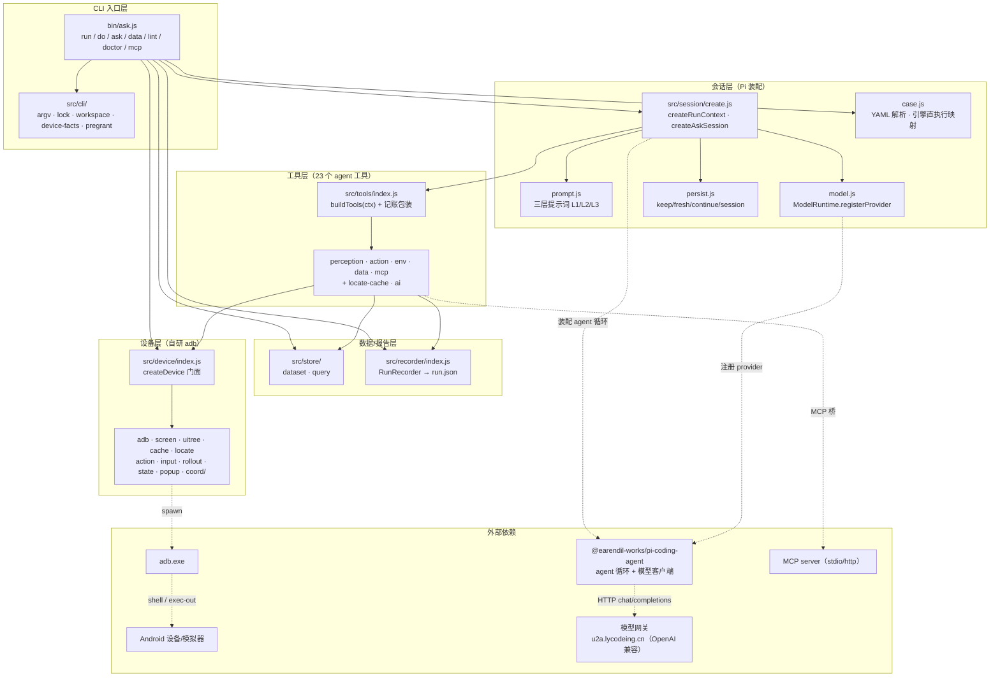
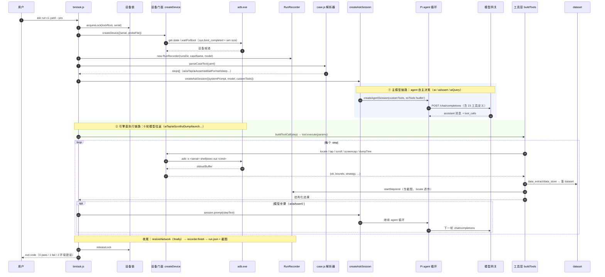
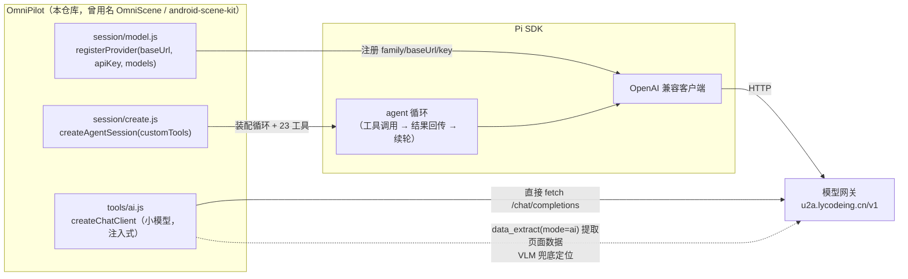
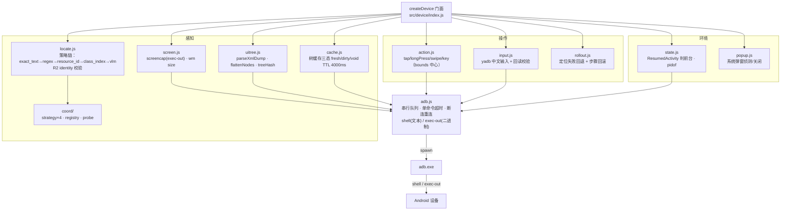
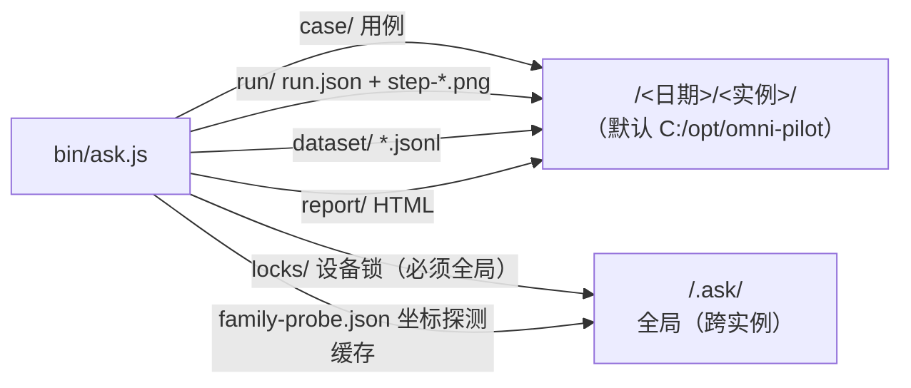
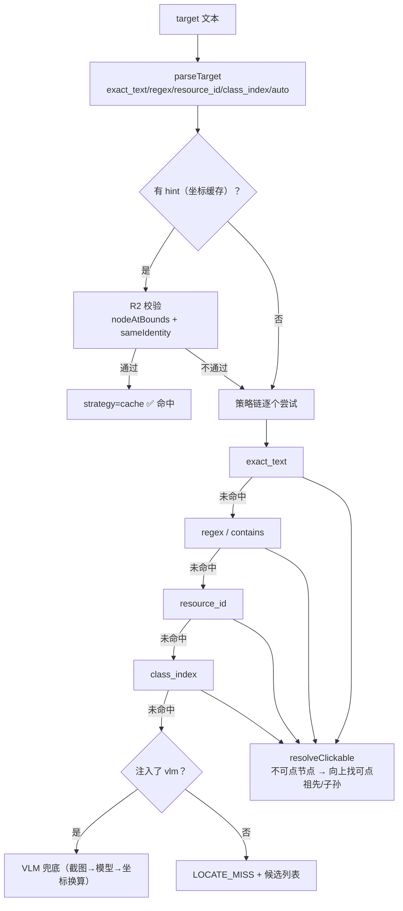

# 架构总览：Agent / ADB / 模型 的调用关系

> 依据实际代码（`bin/ask.js`、`src/{session,tools,device,mcp,store,recorder}/`）整理，2026-10-27。
> 校验：`npm run docs:check` 会验证本文 mermaid 图可渲染。

## 1. 分层全貌（严格单向依赖）

**依赖方向铁律**（契约 §2.2）：`bin/ask.js → session → tools → {device, net, store, mcp}`。
下层不认识上层；`tools` 内**只调 `ctx.device` 门面，禁止直接跑 adb**。

## 2. 一次 `ask run <case>` 的完整调用时序

## 3. 三个模型调用点（都在 Pi SDK 内部，本 kit 只做装配）

**三个调用点**：

| # | 位置 | 用途 | 触发 |
|---|---|---|---|
| 1 | Pi agent 循环（`createAgentSession`） | **主模型**，决定调哪个工具 | `ai` / `aiAssert` / `aiQuery` 步骤 |
| 2 | `createChatClient`（`src/tools/ai.js`） | **小模型**：AI 数据提取 | `data_extract(mode=ai)` |
| 3 | 同上（VLM 注入 `ctx.vlm`） | **VLM 兜底定位** | 定位链末端（`--vlm-locate`） |

> 实测：主模型单轮往返 **deepseek-v4.1-flash 3.7s** vs **glm-5.3-flash 16.2s**（差 4.4×）。
> `thinkingLevelMap` 把 `off` 映射为 `reasoning_effort: 'none'`（deepseek 敏感：14.8s → 1.7s）。

## 4. 设备层内部（`createDevice` 门面之下）

## 5. 产物落点（运行时产物与源码分离）

## 6. 单次定位（`locate`）的内部策略链

## 7. 关键设计约束（来自 CONTRACT-CORE.md）

| 约束 | 内容 |
|---|---|
| 依赖方向 | `bin → session → tools → {device, net, store, mcp}` 严格单向 |
| 工具边界 | 工具**只调 `ctx.device` 门面**，禁止直接跑 adb（保证可 mock、可替换） |
| 23 个工具 | 感知 5 · 操作 8 · 环境 5 · 数据 5（+MCP 动态） |
| 设备锁 | **全局**（`<ASK_HOME>/.ask/locks/`），跨实例共享——否则锁失效 |
| 产物分离 | 用例/记录/数据/报告落工作区，不污染源码树 |
| 截图双份 | 报告用**原图**（取证）；进模型上下文用 **JPEG 压缩**（省 78% tokens） |
