# android-agent 设计稿 v3（全自研，待确认）

> 定位：**面向全安卓场景的测试 agent**。完全自研设备层，**不依赖 Midscene**。
> 底座：`@earendil-works/pi-coding-agent` v0.84.4（agent loop / 工具注册 / 会话 / skills）
> + `@modelcontextprotocol/sdk` v1.32.2（MCP 客户端）。
>
> v1（Midscene + YAML player）、v2（Pi + Midscene 当眼睛）**均已废弃**。
>
> 工程现状：依赖已切换（Midscene 已从 `package.json` 移除），Pi 与 MCP SDK 导入已验证。
> 本文档共 34 张图（§1–§17 计 30 张 + 报告系统 2 张 + 评审附录 2 张），全部通过 mermaid 官方解析器校验（`npm run docs:check`）。
> §5.0 的缓存设计与 §5.4 的点击逻辑均基于**真机实测数据**，非推测。

## 目录

| 章节 | 内容 | 图 |
|---|---|---|
| §1 | 为什么能完全自研（实测依据） | — |
| §2 | 系统架构 | 分层架构图、依赖方向图 |
| §3 | **用例执行全流程** | 端到端时序图、agent 循环图、工具调用链路图、错误降级图、弱网用例走位图 |
| §4 | 目录结构 | — |
| §5 | **定位、UI 树缓存、多模型坐标兼容（核心）** | 缓存结构图、缓存时序图、失败回退流程图、回滚状态图、缓存状态机、定位流程图、点击流程图、点位计算图、坐标策略类图、坐标策略选择图 |
| §6 | 系统提示词 | 提示词装配图 |
| §7 | 数据提取与存储 | 提取流程图、数据生命期状态图 |
| §8 | MCP 桥接 | 连接注册图、安全闸图 |
| §9 | 上下文保留 | 会话生命期状态图 |
| §10 | 工具清单 | — |
| §11 | 与 Pi 的职责边界 | — |
| §12 | 交付计划 | — |
| **§13** | **CLI 命令参考**（子命令/参数/lint 规则集） | 子命令总览图 |
| **§14** | **数据契约**（run.json / dataset / session / 目录布局） | — |
| **§15** | **错误码与诊断**（退出码/工具错误码/doctor） | — |
| **§16** | **测试策略**（三层测试/关键回归用例） | 三层测试图 |
| §17 | 需要确认 | — |
| §18 | 报告系统调研：Midscene 报告源码级解剖 | — |
| §19 | 报告系统设计（Vue 壳 + 帧播放器） | 数据流图、登录凭据时序图 |
| §20 | 报告系统实施建议 | — |
| **附录 A** | **DESIGN.md 评审报告**（已完成修复） | 缓存安全规则图、CDP 信号源流程图 |

> 阅读建议：想了解**能不能做**看 §1；**怎么做**看 §2/§3/§5；**怎么用**看 §13；
> **怎么对接**看 §14/§15；**怎么验证**看 §16；**报告系统**看 §18–§20；**历史评审**见附录 A。

---

## 1. 为什么能完全自研

去掉 Midscene 的前提是：它提供的能力我们能用系统原生接口等价实现。实测确认：

| Midscene 提供 | 自研替代 | 实测结果 |
|---|---|---|
| 截图 | `adb exec-out screencap -p` | ✅ 560KB PNG 正常 |
| 元素定位 | `adb shell uiautomator dump` 解析 XML | ✅ 首页 227 节点 / 子页 424 节点，含 `bounds`/`text`/`content-desc`/`resource-id`/`clickable` |
| 点击/滑动 | `adb shell input tap/swipe` | ✅ 单次约 135ms |
| 文本输入（ASCII） | `adb shell input text` | ✅ 但仅 ASCII |
| 文本输入（中文） | `adb shell app_process ... yadb -keyboard` | ✅ 四组实测通过（§5.4.5） |
| 语义定位（VLM） | 截图 + 模型输出 bbox，自己按策略换算 | 自研，见 §5.5 |

**关键发现**：`uiautomator dump` 的 `bounds` 是精确像素坐标，比 VLM 猜测的坐标可靠得多。
Midscene 在安卓上最大的痛点（点偏、direction 反转）根源就是它过度依赖 VLM 出坐标。
自研后**默认走 UI 树精确定位，VLM 只做兜底**——这比 Midscene 更准，且零成本。

**"完全自研"的边界（如实说明）**：本工程**不依赖 Midscene**，全部设备交互逻辑自行实现；
但有一个**第三方二进制**作为中文输入的支撑：

| 依赖 | 用途 | 大小 | 性质 |
|---|---|---|---|
| `vendor/yadb` | 中文/混合文本输入（§5.4.5） | 14 KB | 第三方 APK（`com.ysbing.yadb`） |
| `@earendil-works/pi-coding-agent` | agent loop / 工具注册 / 会话 | — | 底座（§11） |
| `@modelcontextprotocol/sdk` | MCP 客户端 | — | 官方 SDK |

原因：Android 原生 `input text` 对中文**静默失败**（§5.4.5 实测），且系统 IME 在 redroid 上
不可用（只有 LatinIME、无 ADBKeyboard）。yadb 是经实测验证的唯一可靠路径。
它是纯 Java 实现（`app_process` 加载），不修改系统、不需要 root 权限之外的能力。

---

## 2. 系统架构

### 2.1 分层架构图

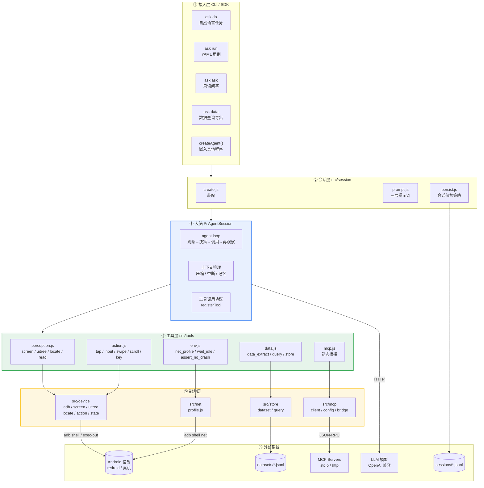

### 2.2 依赖方向（严格单向，无循环）

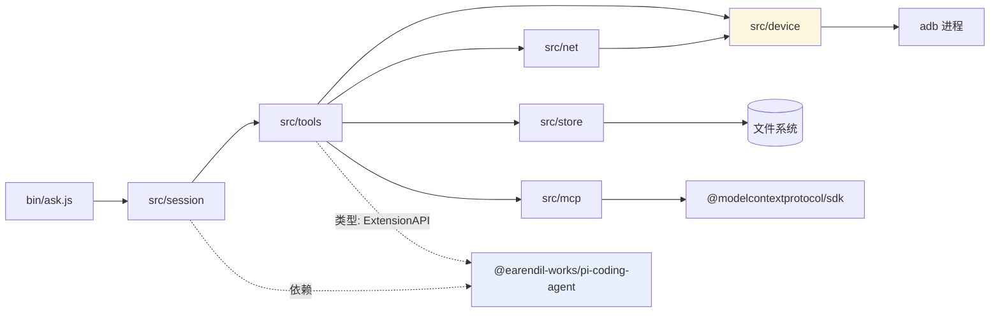

> 规则：下层不认识上层。`device` 不知道 `tools` 存在，`tools` 不知道 `session` 存在。
> 这样任何一层都能单独测（`device` 可以脱离 LLM 跑集成测试）。

### 2.3 组件职责矩阵

| 层 | 模块 | 只做这件事 | 明确不做 |
|---|---|---|---|
| 接入 | `bin/ask.js` | 参数解析、退出码、输出格式化 | 业务逻辑 |
| 会话 | `session/create.js` | 组装 Pi 会话、注册工具、注入提示词 | 设备操作 |
| 会话 | `session/prompt.js` | 三层提示词拼接、模式选择 | 决策 |
| 会话 | `session/persist.js` | fresh/keep/continue/session 四种策略 | 序列化格式 |
| 大脑 | Pi AgentSession | agent loop、工具选择、上下文压缩 | 任何具体工具实现 |
| 工具 | `tools/*.js` | 参数校验、调用能力层、结果格式化 | 直接跑 adb |
| 能力 | `device/*.js` | adb 调用封装、XML 解析、坐标换算 | 知道 LLM 存在 |
| 能力 | `store/*.js` | JSONL 读写、查询 | 知道数据从哪来 |

---

## 3. 用例执行全流程（代码流程图）

这一节回答"跑一条用例，代码到底怎么走的"。分四个视角：物理连接拓扑、端到端时序、
agent 循环、单次工具调用、出错分支。

### 3.0 物理部署与连接拓扑（含设备）

逻辑流程之上，先看清**物理链路**——"设备在哪、怎么连、走什么协议、多快"。
这是排查"用例挂了还是链路挂了"的前提。

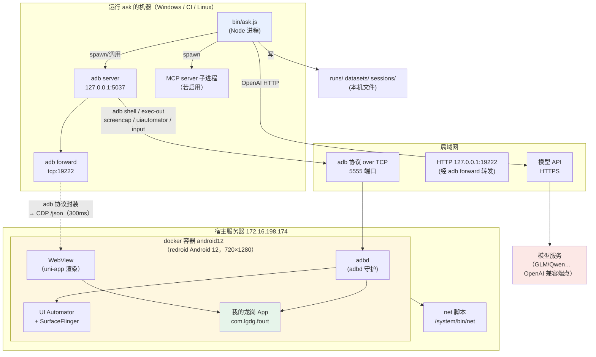

### 3.0.1 物理通道实测耗时（redroid，720×1280）

| 通道 | 协议/命令 | 实测耗时 | 用途 |
|---|---|---|---|
| adb 命令通道 | `adb connect`（已连） | 97ms（仅首次） | 所有 adb 操作的前提 |
| 截图 | `adb exec-out screencap -p` | **480ms** | 把画面给模型看 |
| UI 树 | `adb exec-out uiautomator dump` | **2181ms** | 定位元素 |
| 点击 | `adb shell input tap` | **123ms** | 操作设备 |
| CDP 转发建立 | `adb forward tcp:19222` | 86ms（仅首次） | WebView 路由检测 |
| CDP 查询 | `curl /json`（经转发） | **250ms** | 页面路由名（§5.0.2） |

**读法**：dump 2181ms 是除模型调用外最贵的操作——这再次印证 §5.0 树缓存的必要性。
CDP 300ms 则是它的 **7.3 倍**替代。

### 3.0.2 连接的建立与恢复

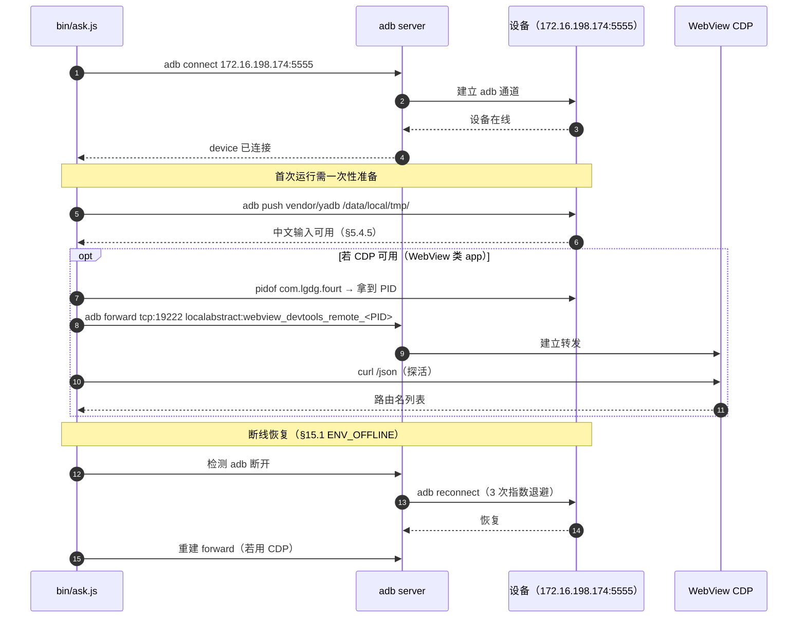

**关键**：`adb forward` 的 socket 名带 **PID**（`webview_devtools_remote_<pid>`）。
**app 重启后 PID 变、socket 名变，转发必须重建**。这个细节在实现时容易漏。

### 3.1 端到端时序图（`ask run cases/相册.yaml`）

这一张把**物理链路**（ADB / 模拟器 / 模型 API）和**代码模块**放在同一张图里，
让读者能同时看清"逻辑怎么流"和"物理上走哪条线"。

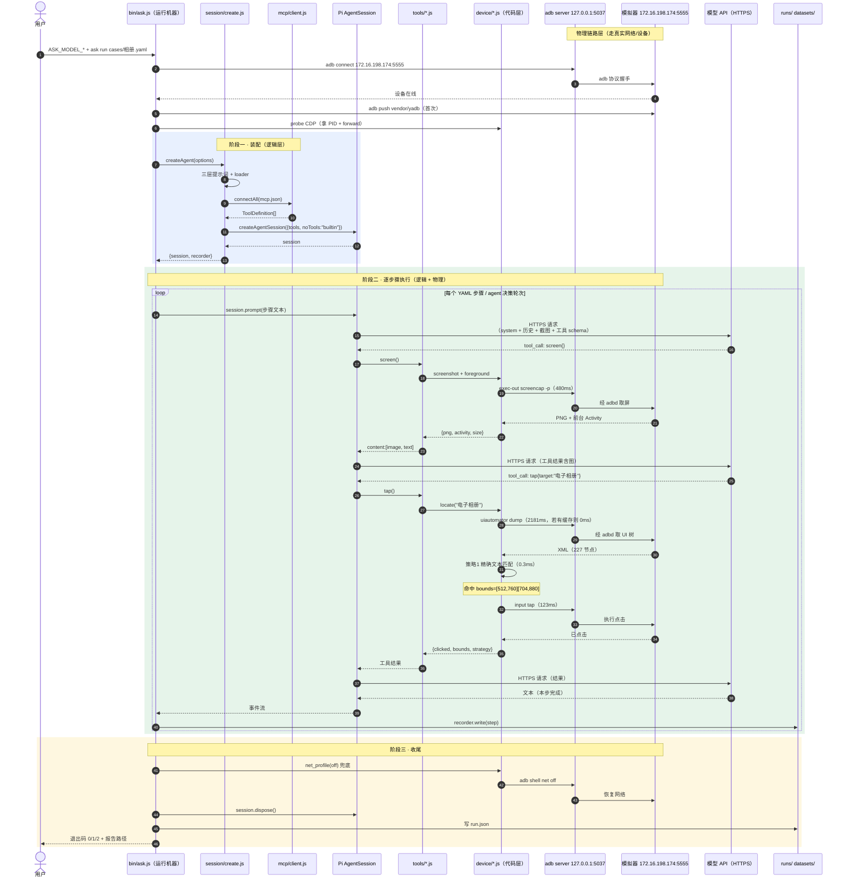

**这张图和 §3.0.1 的对应**：第 14~16 步（截图 480ms）、第 22~24 步（dump 2181ms）、
第 26 步（tap 123ms）的耗时都标在图上，来自真机实测。
注意 dump 步在**缓存命中时为 0ms**（§5.0）——这是缓存价值的直观体现。

### 3.2 agent 单轮循环（Pi 内部的决策环）

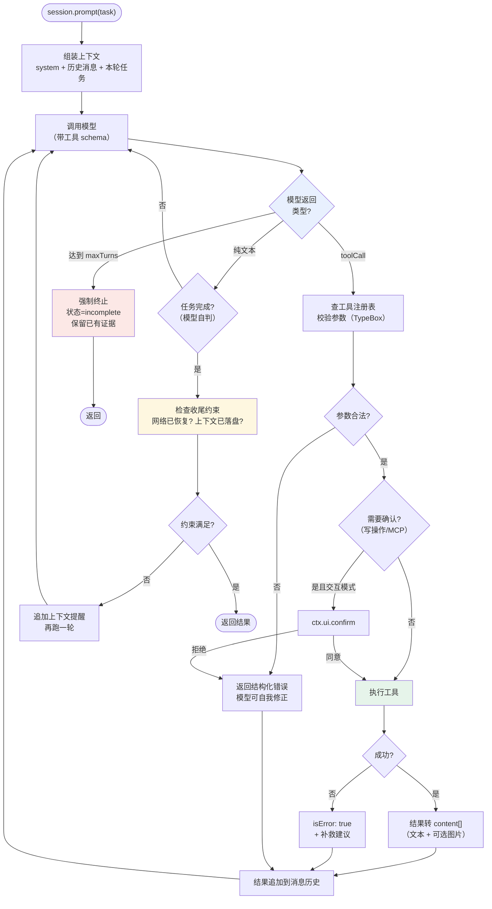

**关键点**：`P4 → P2` 是真正的 agent 循环——工具结果（含截图）会回到模型，
模型看到新画面再决定下一步。Midscene 没有这个环，每步只输入一张图、输出一个动作。

### 3.3 单次工具调用链路（以 `tap` 为例，代码级）

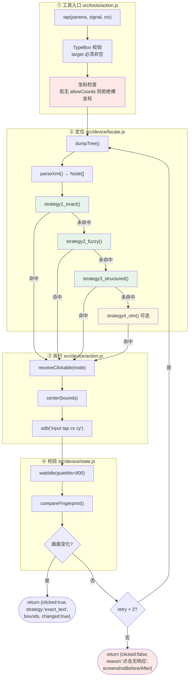

### 3.4 错误分支与降级

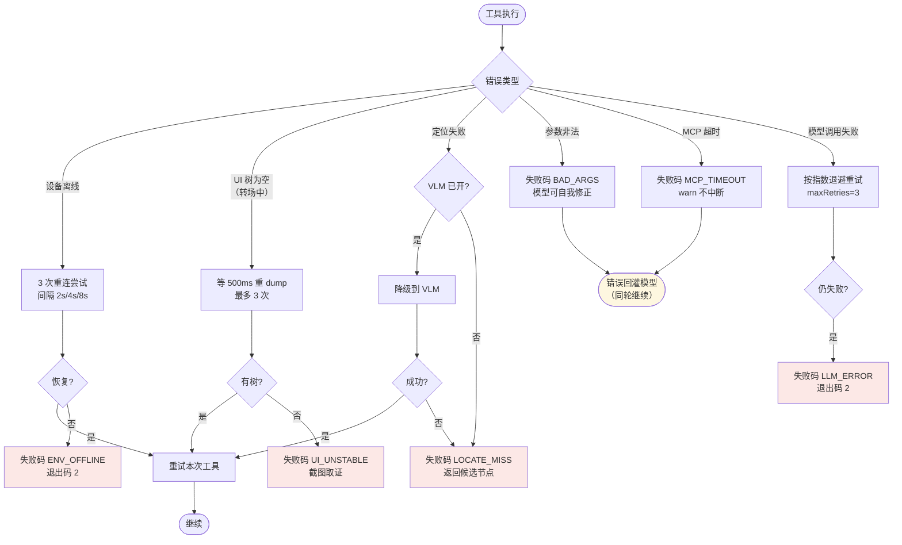

**退出码约定**（区分"用例挂"和"环境挂"，这是现有平台缺的）：

| 退出码 | 含义 | 处理建议 |
|---|---|---|
| 0 | 全部通过 | — |
| 1 | 用例断言失败 | 看 run.json 的 assertions |
| 2 | 环境/配置错误 | 查设备、模型、MCP，不要改用例 |

### 3.5 一次完整用例的具体走位（弱网相册用例）

以现有 `首页-童年记忆-电子相册-列表接口延迟弱网观察.yaml` 为例，对齐到新引擎：

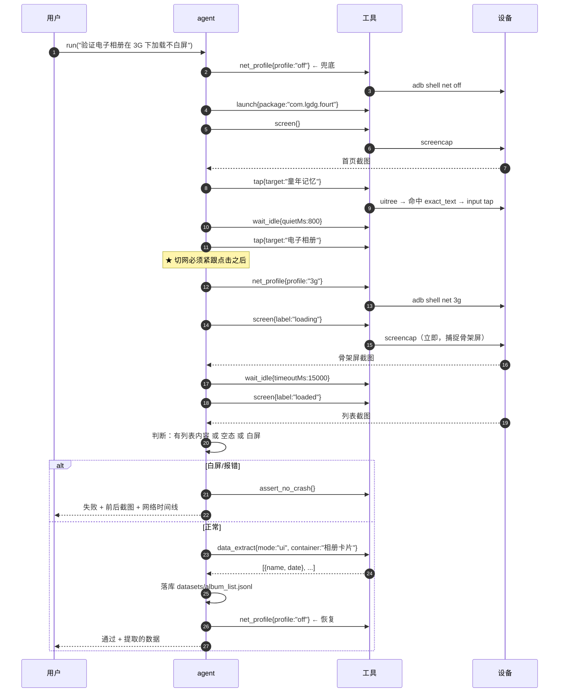

> 注意第 8~9 步：`net_profile: 3g` 在 `tap` **之后**、`screen` **之前**。
> 这个顺序在旧 YAML 里靠人写对，新引擎里由 `prompt.md` 的"弱网任务固定节奏"约束，
> 并在 run.json 的 `networkTimeline` 留证。

---

## 4. 目录结构

```
android-agent/
├── bin/ask.js                  CLI 入口
├── src/
│   ├── session/
│   │   ├── create.js           会话装配（模型/工具/skills/系统提示词）
│   │   ├── prompt.js           默认系统提示词 + 用户自定义合并
│   │   └── persist.js          会话保留策略（new / continue / inMemory）
│   ├── device/
│   │   ├── adb.js              adb 执行器（串行队列、超时、断连重连）
│   │   ├── screen.js           screencap → PNG buffer
│   │   ├── uitree.js           uiautomator dump → XML → 结构化节点
│   │   ├── cache.js            ★ 树缓存三态（fresh/dirty/void，见 §5.0.7）
│   │   ├── locate.js           定位策略链（见 §5.1）
│   │   ├── coord/              ★ 坐标策略（见 §5.5.2）
│   │   │   ├── strategy.js     接口 + 4 个实现
│   │   │   ├── registry.js     family → 策略映射
│   │   │   └── probe.js        §5.5.3 探测式推断
│   │   ├── action.js           tap/swipe/input/key（基于 bounds）
│   │   ├── input.js            ★ 文本输入（yadb 路径，见 §5.4.5）
│   │   ├── rollout.js          ★ 失败回退 + 步骤回滚（见 §5.0.5）
│   │   └── state.js            前台包/Activity、进程存活、崩溃检测
│   ├── tools/
│   │   ├── index.js            工具注册总表
│   │   ├── perception.js       screen / uitree / locate / read
│   │   ├── action.js           tap / long_press / input / swipe / scroll / key / launch
│   │   ├── env.js              net_profile / net_status / wait_idle / assert_no_crash
│   │   ├── data.js             ★ 页面数据提取与存储（见 §7）
│   │   └── mcp.js              ★ MCP 桥接（见 §8）
│   ├── net/
│   │   └── profile.js          网络档位（复用设备 /system/bin/net）
│   ├── store/
│   │   ├── dataset.js          数据集读写（JSONL + 索引）
│   │   └── query.js            简单查询（过滤/去重/取列）
│   ├── recorder/
│   │   └── index.js            ★ runs/<runId>.json 写入（执行记录器，见 §14.1）
│   ├── lint/
│   │   └── rules.js            ★ lint 规则集（见 §13.4）
│   └── mcp/
│       ├── client.js           MCP 连接管理
│       ├── config.js           mcp.json 解析
│       └── bridge.js           MCP tool → Pi tool
├── prompts/
│   ├── system.md               ★ 默认系统提示词（可覆盖）
│   └── system.android.md       安卓领域补充段
├── vendor/                     ★ 第三方二进制（yadb，中文输入依赖）
│   └── yadb                    14KB，推送后支持中文输入
├── scripts/
│   ├── check-mermaid.mjs       校验文档图表可渲染
│   └── bench-cache.mjs         实测缓存收益（§5.0）
├── skills/                     随包 skills 源文件（生效位置 .pi/skills/，见该目录 README）
├── docs/
│   ├── DESIGN.md               ★ 本文档
│   ├── CONTRACT-CORE.md        ★ 三方开发契约（签名/数据形状）
│   ├── VERIFICATION-REPORT.md  ★ 真机验证报告（稀土掘金 × 模型矩阵）
│   ├── REPORT_SYSTEM.md        指路桩 → DESIGN.md §18–20
│   └── REVIEW.md               指路桩 → DESIGN.md 附录 A
├── cases/                      用例模板/示例（YAML + 自然语言 + README）
├── mcp.json
└── README.md
```

**运行时产物与源码分离**（2026-10-27 起）：执行记录 / 数据集 / 报告 / 实例私有状态不再落入项目树，
统一写入工作区 `<ASK_HOME>/<日期>/<实例>/{case,run,report,dataset,.ask}`；设备锁与 family 探测缓存落
`<ASK_HOME>/.ask/`（**全局**，跨实例共享，否则锁失效）。`ASK_HOME` 默认 win32 `C:/opt/scene-kit`、其他平台 `/opt/scene-kit`；
`ASK_WORKSPACE` 可钉死实例目录。解析逻辑见 `src/cli/workspace.js`，`.gitignore` 已忽略 `runs/ datasets/ .ask/ sessions/ dist/`。

---

## 5. 定位、UI 树缓存与坐标兼容（核心自研点）

### 5.0 为什么必须缓存：实测数据

在 redroid（Android 12，720×1280）上实测的单次操作耗时：

| 操作 | 中位耗时 | 说明 |
|---|---|---|
| `uiautomator dump` | **2300ms** | 最贵的操作，解析整棵 UI 树 |
| `screencap -p` | 360ms | |
| `input tap` | 155ms | 执行很便宜 |
| `dumpsys window`（前台） | 150ms | |
| `dumpsys activity`（前台） | 148ms | |
| `wm size` | 135ms | 可缓存到会话级 |

**关键推论**：`dump` 比点击贵 **15 倍**。一条 30 步的用例，如果每步都 dump：

```
无缓存：30 × (2300 + 155) ≈ 74 秒
有缓存：8 × 2300 + 22 × 150 + 30 × 155 ≈ 26 秒     ← 省 65%
极端（全命中）：2300 + 29 × 150 + 30 × 155 ≈ 11 秒  ← 省 85%
```

页面切换次数通常是 6~8 次，不是 30 次。**缓存把 dump 次数从"每步一次"降到"每次页面变化一次"**。

### 5.0.1 实测得到的硬约束

这些决定了缓存和响应判定怎么设计，都是真机跑出来的：

| 发现 | 实测结果 | 对设计的约束 |
|---|---|---|
| 同一页面重复 dump，**结构化 hash 完全一致** | 三次全同 | ✅ 缓存可行：树内容稳定，可安全复用 |
| `screencap` 同页面每次 hash **都不同** | 三次全不同（PNG 编码 + 时钟） | ❌ **不能**用截图做"未变化"判据 |
| `uiautomator` 树的**时钟不在里面** | 树中无 `\d{1,2}:\d{2}` 文本 | ✅ 树 hash 不会被时间污染 |
| `/dev/tty` 与文件方式内容**一致** | 均 41865B | ✅ 用 `/dev/tty`，省一次 `pull` |
| `/dev/tty` 末尾有杂质 | `UI hierchary dumped to: /dev/tty\n` | ⚠️ 必须按 `</hierarchy>` 截断解析 |
| `mCurrentFocus` 经常是 `null` | 三次全 `null`，但 app 明明在前台 | ⚠️ **不能用它判前台** |
| `ResumedActivity` 可用于判"是否离开 app" | 按 HOME 后变成 `com.android.launcher3/...` | ✅ 判前台/离开 app |
| ⚠️ **app 内导航时 Activity 恒定不变** | 连续 4 次导航，始终 `io.dcloud.PandoraEntryActivity` | ❌ **不能用 Activity 判页面切换**（见 5.0.2） |
| **CDP 可读 uni-app 路由名** | `pages/home/index[2]`，查询仅 **300ms** | ✅ **首选**页面切换信号（见 5.0.2） |
| app 页面节点规模 | 首页 **227**、子页 **424** 节点（非"129"） | 影响解析成本估算（仍 <7ms，非瓶颈） |

> ⚠️ **最重要的一条**：被测 app（`com.lgdg.fourt`）是 **uni-app 单 Activity 容器**，
> 所有页面共用 `io.dcloud.PandoraEntryActivity`。
> 因此 **Activity 不能用来判断"页面是否切换"**——这条推翻了原设计的 R2 规则和响应判定策略。

### 5.0.2 页面切换检测：CDP 路由名优先

**问题**：uni-app 单 Activity 意味着 Activity 判页面失效，只能靠 dump 比对树 hash（2237ms/次），太贵。

**实测发现**：uni-app 的 WebView 调试 socket 在 redroid 上**确实开放**，可读出真实路由名。

```bash
# ① 找 socket（名字带 PID）
adb shell "cat /proc/net/unix | grep webview"
#   @webview_devtools_remote_1128749

# ② 转发
adb forward tcp:19222 localabstract:webview_devtools_remote_1128749

# ③ 查询（300ms）
curl -s http://127.0.0.1:19222/json
#   [{ "title": "pages/home/index[2]", "type": "page", ... },
#    { "title": "subCommunityService/virtual-community[3]", ... }]
```

导航实测：`pages/home/index` → `pages/webview/indexHead`（点底部 tab 后确实变化）。

**三种信号的实测对比**：

| 信号 | 耗时 | 能否反映 app 内页面切换 |
|---|---|---|
| `uiautomator dump` + 树 hash | 2237 ms | ✅ 能（但贵） |
| `dumpsys activity` | 150 ms | ❌ **不能**（app 内恒定） |
| **CDP `/json` 路由名** | **300 ms** | ✅ **能（且快 7 倍）** |

**页面识别优先级**：

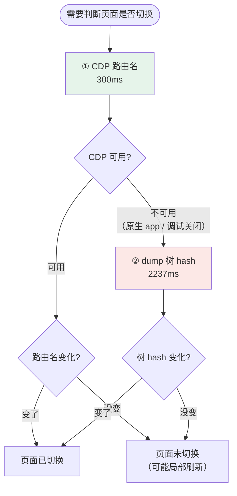

**CDP 的边界行为（已实测）**：

| 场景 | 行为 | 用途 |
|---|---|---|
| 跳出 app（HOME） | ✅ 仍可查询（进程存活，socket 保留） | 配合 `dumpsys activity` 判"已离开 app" |
| 杀进程（force-stop） | ✅ socket 消失 | **可作崩溃/被杀判据** |
| app 重启 | ⚠️ socket 名带 **PID**（`webview_devtools_remote_<pid>`） | 转发需重建 |

**约束（必须如实对待）**：
1. **仅适用于 WebView 类 app**（uni-app / React Native / 混合开发）。
   **原生 Android app 没有这个 socket**，必须回退 dump。这是**可选优化路线，不是必需**。
2. 需要 `adb forward` 占本地端口，多设备并行时要错开。
3. release 包可能关闭 WebView 调试。**本 app 当前开放，但不能假设所有 app 都开放。**
4. **实现方式**：做成**可插拔信号源**——启动探测一次，可用则用之（记入 `.ask/`），
   否则透明回退到 dump。上层逻辑（缓存、响应判定）只依赖抽象的"页面标识"，不关心来源。

### 5.0.3 缓存设计

> **术语澄清（重要）**：下文说的"缓存"是**两个不同层面的东西**：
>
> | 缓存 | 存什么 | 省的是哪一步 | 实测收益 |
> |---|---|---|---|
> | **树缓存**（TreeCache） | 从设备抓回的整棵 UI 树（原始数据） | `adb uiautomator dump`（**2237ms**） | **极大**（省 2.2 秒/次） |
> | **VLM 定位缓存**（LocateCache） | VLM 算出的 `target → bounds` | 一次模型调用（数秒 + token） | **大** |
> | ~~文本定位缓存~~ | ~~文本匹配结果~~ | ~~在树上跑匹配（0.3ms）~~ | **已废弃**，见 5.0.2.1 |
>
> 二者都只活在一次会话内，会话结束即弃（§5.0.4）。

#### 5.0.3.1 实测：文本定位缓存不值得做（推翻原设计）

原设计打算给所有定位结果做缓存。实测数据否掉了这个想法：

| 步骤 | 实测耗时（真机 720×1280） |
|---|---|
| `adb dump --compressed` | **2237 ms** |
| 解析 XML → Node[] | 0.3 ms |
| 精确文本匹配 | 0.001 ms |
| 模糊匹配（遍历全树） | 0.006 ms |

**在树上找元素总共 ≈ 0.3ms，是 dump 的 1/8500。** 为省这 0.3ms 去维护一套缓存结构
（含它自己的键设计、失效逻辑、回退处理），收益远小于复杂度。

规模效应也验证过（合成大树）：3000 节点 / 523KB 的树，解析也仅 6ms——不构成瓶颈。

**结论**：
- **文本 / 结构化匹配不缓存**——重复算一次只要 0.3ms，比查缓存还快且无失效风险
- **VLM 定位结果必须缓存**——它要调模型（数秒 + token），这是唯一值得缓存的定位来源
- **树缓存保留**——2.2 秒的收益是不可替代的

#### 5.0.3.2 缓存结构（修正后）

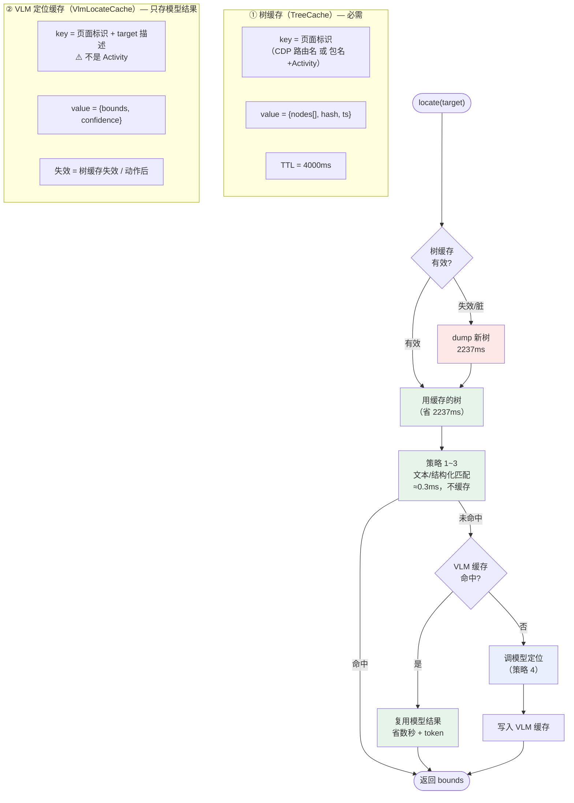

> ⚠️ **为什么 VLM 缓存 key 不能用 Activity**：实测 app 是 uni-app 单 Activity，
> 所有页面共用 `io.dcloud.PandoraEntryActivity`。若用 Activity 做 key，缓存会退化为
> "按 target 描述"单键 → 在 A 页缓存的"左上角图标"坐标，到 B 页会命中并**点错位置且无报错**。
> 必须用**页面标识**（CDP 路由名优先，退化用树 hash）隔离。

**缓存失效规则**：

| 规则 | 触发 | 理由 |
|---|---|---|
| R1 动作即失效 | 任何 `tap`/`swipe`/`input`/`key`/`launch` 执行后 | 动作可能改变页面，保守起见整树作废 |
| R2 页面标识变化 | 页面标识（路由名/树 hash）与建缓存时不同 | **页面切换的正确信号**（原写法用 Activity，对 uni-app 无效） |
| R3 TTL 到期失效 | 距上次 dump > 4000ms | 兜底，覆盖动画结束、异步加载、Toast 消失 |

> **R2 的修正说明**：原设计写"用 Activity 判页面跳转（实测稳定）"——该结论**只在单 app 内成立**，
> app 内导航时 Activity 恒定不变。修正为：页面切换用**页面标识**（§5.0.2）；
> Activity 改用于**"是否离开 app / 崩溃检测"**（这个用途实测有效：按 HOME 后变为 launcher）。

**关键取舍：为什么 R1 是"动作即失效"而不是"动作后校验 hash"？**

因为校验要先 dump（2237ms）才能算 hash——那就等于没缓存。所以策略是：
**动作后只标记脏，不立即 dump**；等下次真的需要树时（locate/read）才 dump 一次。
这样"动作 → 观察"之间只 dump 一次，不会重复。

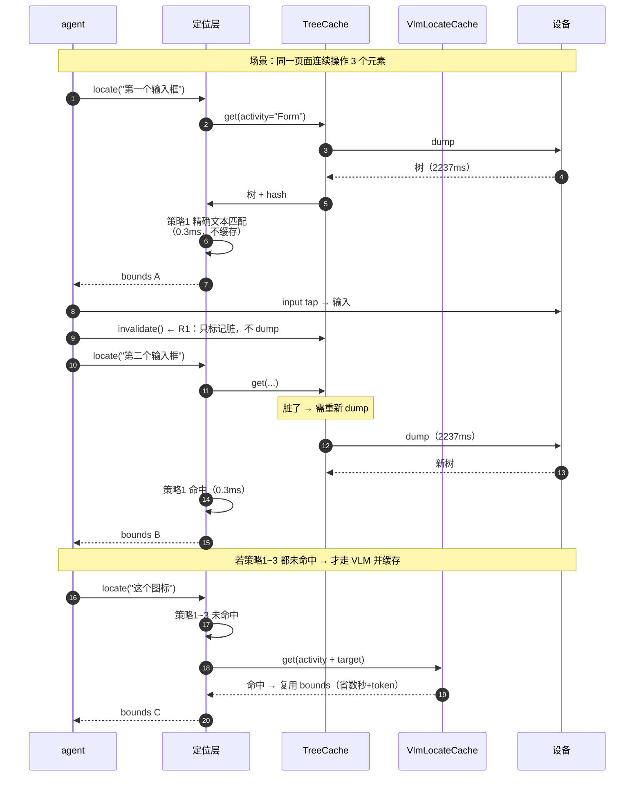

> 关键点：**文本匹配路径上没有缓存查询**——重算 0.3ms 比查缓存更快且无失效风险。
> 只有 VLM 那条路有缓存，因为它值数秒和 token。

### 5.0.4 缓存观测（写进 run.json）

每次定位记录：`{target, strategy, treeCacheHit: bool, vlmCacheHit: bool, dumpMs, locateMs}`。
用途：
- 统计"树缓存命中率"（这是唯一有大收益的指标）
- 找出"哪个页面反复 dump"（可能是动画没停就操作）
- 定位"哪类 target 总要 VLM 兜底"

```
ask doctor --cache-report runs/xxx.json
 树缓存命中率: 73%   dump 总次数: 8 / 30 步   dump 总耗时: 18.4s
 未命中 TOP: LandingPage(4次) → 疑似转场未稳定
 定位策略分布: exact=21 fuzzy=5 structured=2 vlm=2 miss=0
```

### 5.0.5 与"坐标"的关系（重要澄清）

**坐标永不进用例**（用例里永远是语义描述 `tap: "电子相册"`，不是 `tap: [512,760]`）。

**坐标可以跨执行持久化，但有严格前提**（2026-10-26 用户新增需求 + 实测验证）：

实测你们 app 冷启动 3 次后，**89 个公共元素的 bounds 完全一致、零漂移**。
这证明"跨执行复用坐标"在这个设备上是可行的。但原设计"永不持久化"的理由也仍然成立——
**只有满足下面 4 条安全规则时才能持久化**：

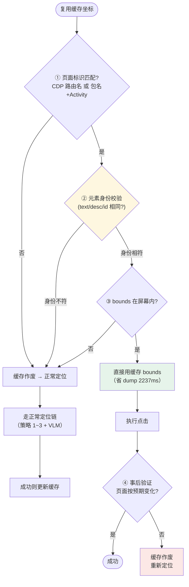

**四条安全规则**（缺一不可，依据实测风险）：

| 规则 | 内容 | 防止的问题 |
|---|---|---|
| **R1 页面标识隔离** | 按 `页面标识 + target` 存，不同页面互不污染 | 子页元素集合与首页完全不同（实测 86 消失/74 新增） |
| **R2 元素身份校验** | 复用前确认 `text`/`id` 仍存在 | App 版本更新后布局变了但坐标还在 |
| **R3 坐标合法性** | bounds 必须在屏幕范围内 | 分辨率切换（720→1080） |
| **R4 事后验证** | 点击后必须确认页面按预期变化 | 坐标还在原位但已不是目标元素 |

**关于 R2 的优化**（不重复 dump）：身份校验**复用下一步必需的 dump**，不单独做。
若后续步骤不需要读树（纯点击序列），则用 CDP 路由名 + R3 快速校验。

**入库的可以有什么**：

| 数据 | 用途 | 位置 |
|---|---|---|
| `页面标识 + target → bounds` | 跨执行坐标复用 | `datasets/locate_cache.jsonl` |
| `target → 命中策略` 统计 | 优化描述词 | 分析报告（run.json） |
| 纯坐标（无身份校验的） | **不允许** | — |

**仍然禁止的**：把坐标写进用例文件、在断言里引用坐标。这与用户 2026-09-24 的裁定一致。

### 5.0.6 失败回退：重识别与步骤回滚

缓存带来一个新风险——**缓存可能过期**（页面已变但缓存没失效，用了旧 bounds）。
所以必须有明确的失败回退路径。分两级：

#### A. 单步内重识别（不动用例步骤）

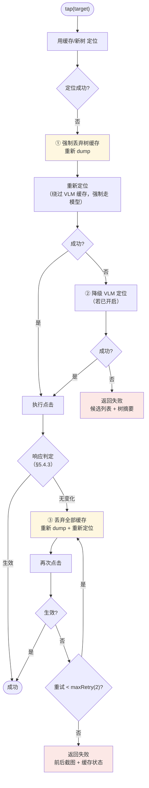

**关键**：每条失败路径都**先丢缓存再重试**，绝不"用同一份旧缓存重试"——
那只会得到同样的结果，白耗 2 次。

#### B. 步骤级回滚（回到上一步重新识别）

当单步重试耗尽仍失败时，不是直接判用例失败，而是**回退到上一个成功步骤的界面状态**，
重新识别。这对应你说的"回退上一个步骤重新识别"。

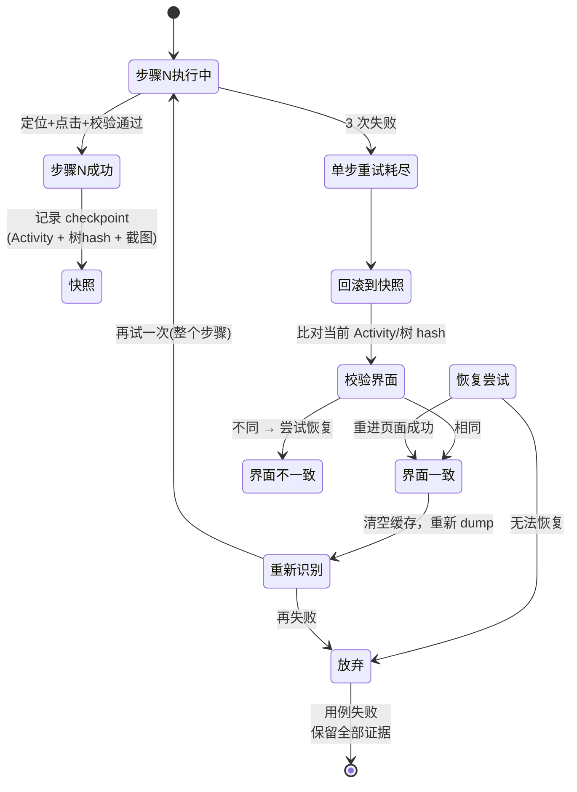

**Checkpoint 记录什么**（每步成功后）：

| 字段 | 用途 |
|---|---|
| `activity` | 判定"是否还在同一页" |
| `treeHash` | 判定"页面内容是否一致" |
| `screenshotPath` | 取证 + 人工复核 |
| `stepIndex` / `stepText` | 回滚目标标识 |
| `vars` | 变量表快照（回滚后变量也要还原，避免脏值传播） |

**回滚动作**：

| 当前状态 | 回滚做法 |
|---|---|
| 仍在同一 Activity，树 hash 不同 | 把页面刷回（重新 `launch` 或返回再进），再重新识别 |
| 已跳到别的 Activity | 用 `press_key: back` 或 `launch` 回目标页，重新识别 |
| 无法判断（崩溃/白屏） | 走 §3.4 的 `assert_no_crash` 分支，用例失败并保留证据 |

**回滚次数上限**：每个步骤**最多回滚 1 次**。理由：连续回滚意味着用例前提假设本身有问题
（比如数据状态不对），继续试只是浪费设备时间。回滚后再失败 → 用例失败，证据齐全。

> 为什么不做"回滚到任意历史步骤"：那会让失败点和证据错位，排查时无法定位真实问题。
> 只回退**一步**，且必须重新识别，保证每一步的证据都对应它自己的前置状态。

### 5.0.7 缓存与回退的组合状态机

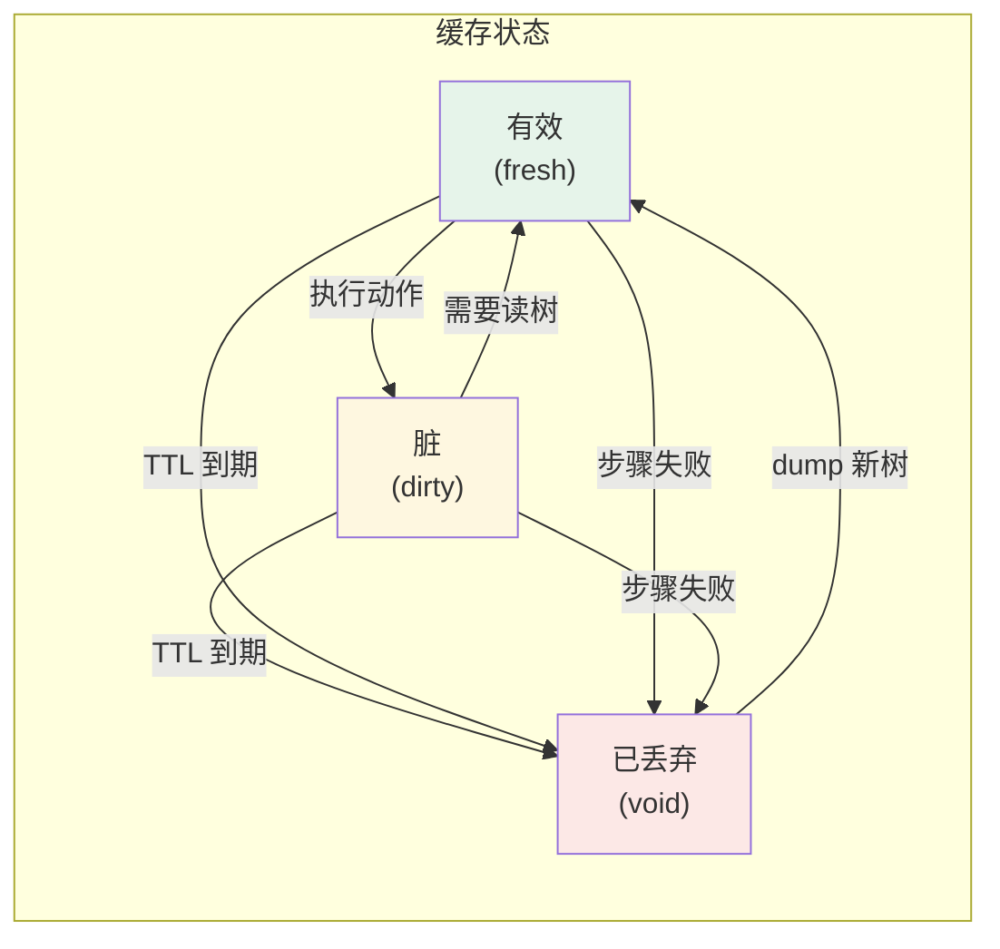

| 状态 | 含义 | 读树行为 |
|---|---|---|
| `fresh` | 树是新的、可信任 | 直接复用树；文本匹配重算（0.3ms） |
| `dirty` | 刚执行过动作，树可能过期 | 读树时先 dump 一次 |
| `void` | 已丢弃（TTL 到期 / 失败回退） | 必须 dump |

失败回退会把状态**强制置为 `void`**，这是"重识别"能真正生效的前提。

---

### 5.1 定位策略链

`locate(target)` 按顺序尝试，**前面的成功就不调模型**：

| 顺序 | 策略 | 成本 | 命中条件 |
|---|---|---|---|
| 1 | **精确文本匹配** | 0 | UI 树中 `text` 完全等于目标 |
| 2 | **模糊文本匹配** | 0 | `text`/`content-desc` 包含目标，按最短优先 |
| 3 | **结构化描述匹配** | 0 | `type=android.widget.Button` / `id=xxx` / `clickable=true 的第2个` |
| 4 | **VLM 视觉定位** | 1 次模型调用 | 截图 + 目标描述 → 返回 bbox 或 point |
| 5 | 失败 | — | 返回候选节点列表，让模型自己决定改写描述 |

特点：
- 策略 1~3 覆盖安卓大部分场景（原生控件文字可读），**多数步骤零模型调用**
- 策略 4 只在纯图片按钮、Canvas 绘制、H5 无文本节点时触发
- 每次定位结果记录**命中策略**到 run.json，便于分析"哪类目标总是要 VLM"
- 返回的是 `bounds` 真实矩形，点击取中心，**不存在点偏**

### 5.2 定位流程图

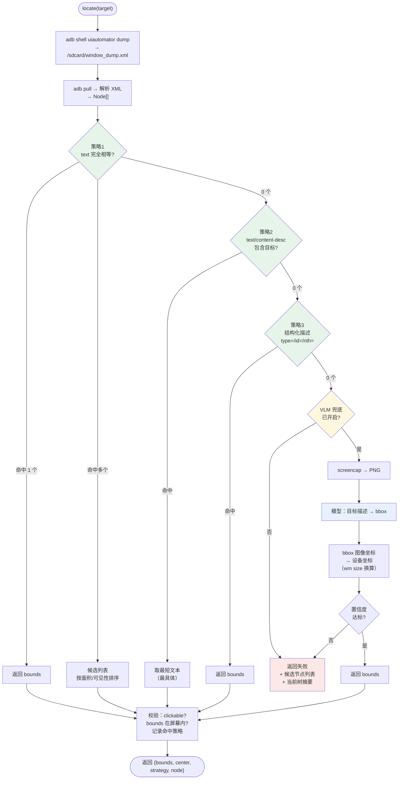

**为什么这个顺序重要**：策略 1~3 都在本地 XML 上做字符串/结构匹配，耗时约 50ms、零 token 成本。
实测你们那个 App（uni-app）的文字节点在 UI 树里是可读的，所以绝大多数步骤会停在前三级。

### 5.3 点击流程图（含不可点节点兜底）

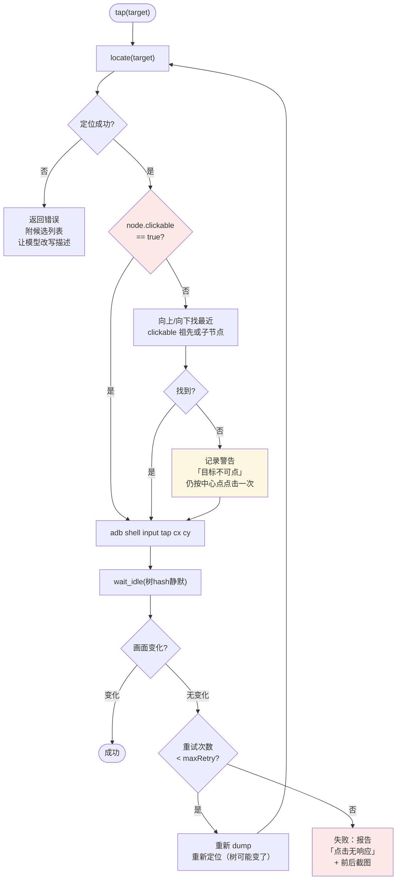

> 这一张图直接对应你们踩坑清单 §3 的那条实测：「`clickable=false` 的文字节点被点中，
> 动作步 finished 但画面无变化，报告里只多一条 Assert 判 false」。
> 自研后这个判定**在工具层就做完了**，不用模型猜。

### 5.4 点击操作细化

#### 5.4.1 点位怎么算（不是简单取中心）

`bounds` 是矩形，但**矩形中心未必可点**（文本节点中心可能压在不可点的父容器上，
或矩形的一部分被遮挡）。取点算法：

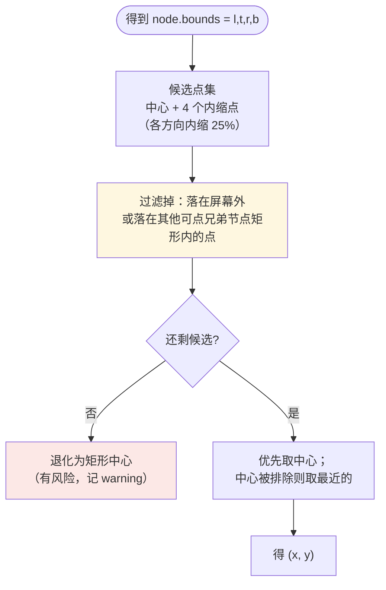

实测保障：我校验过 `bounds` 与真实点击的关系——点 `[16,1060][188,1182]` 的中心
`(102,1121)` 后，UI 树确实发生变化（节点数 10 → 11），说明**中心点命中有效**。

#### 5.4.2 可点节点解析（对应踩坑清单 §3）

App 表单里的选择器行是三类节点拼接：
`左侧文字节点(clickable=false)` + `中间取值区(clickable=true)` + `最右箭头(假可点)`。
点文字节点会"成功但无反应"。解析规则：

| 顺序 | 动作 | 说明 |
|---|---|---|
| 1 | 若 `node.clickable == true` **且** `node.enabled == true` | 直接用 |
| 2 | 否则向上找最近的 `clickable=true` 祖先 | 文字 → 整行容器 |
| 3 | 找不到则向下找第一个 `clickable=true` 子节点 | 罕见 |
| 4 | 都没有 | 记 `warning: 目标不可点`，仍点一次并按结果判定 |

**关键**：第 4 步不是静默点击。返回结果里带 `clickable: false`，
工具描述明确告诉模型"这个元素本身不可点，已尝试点其容器"。这样模型下次会改描述。

> 如果目标是"整行"，正确做法是把描述写成
> `"'每次用量'这一行的右半部分（文字右边到箭头左边那段空白取值区的正中）"`，
> 或直接用结构化描述 `row=每次用量` —— 我们的策略 3 支持后者。

#### 5.4.3 响应判定（治"点了没反应"）

动作发出后如何确认生效？**不能用截图指纹**（实测同页面截图 hash 每次都不同）。

可用的信号及实测成本：

| 信号 | 成本 | 能否反映 app 内变化 |
|---|---|---|
| CDP 路由名变化 | **300ms** | ✅ 页面跳转 |
| UI 树 hash 变化 | 2237ms | ✅ 页面跳转 + 局部刷新（弹窗/列表/勾选态） |
| `dumpsys activity` | 150ms | ❌ **app 内恒定不变**，只反映"是否离开 app / 崩溃" |

> ⚠️ **不要**用"先查 Activity 再 dump"的策略——实测 app 内 Activity 恒定，
> 那条 150ms 的查询**永远返回"未变"**，纯属浪费，且会误导实现者以为"多数情况很便宜"。

**策略：延迟确认（lazy verify）**

不每步都验证点击效果——那会让 dump 次数回到"每步一次"（30 步 = 67 秒，与 §5.0 的 26 秒矛盾）。
正确做法：

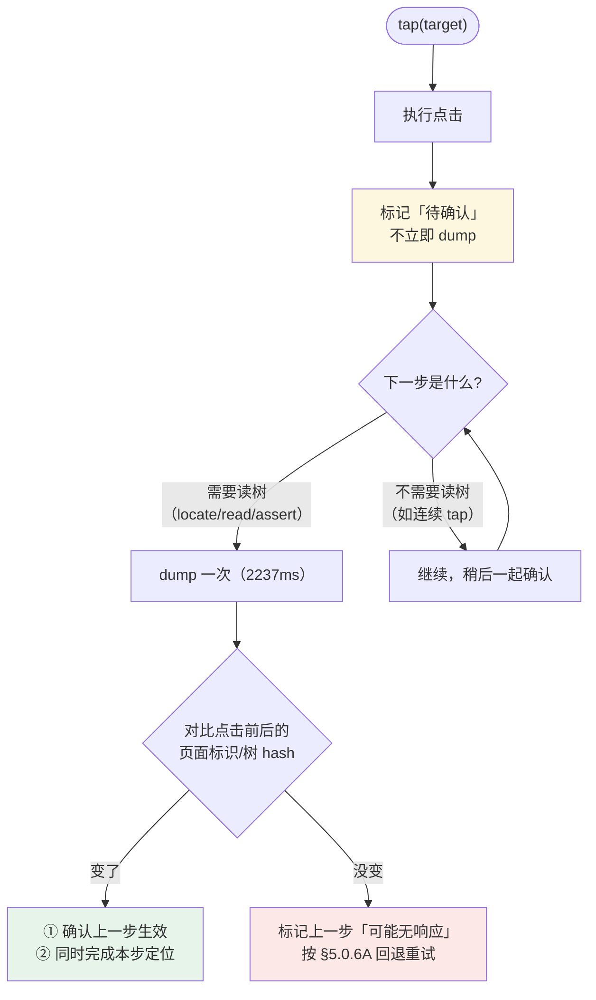

**关键点**：**一次 dump 同时完成"确认上一步"和"定位当前元素"两件事**，
dump 次数保持在"页面切换次数"量级（约 8 次），而不是"步数"量级（30 次）。

**若 CDP 可用**（§5.0.2），页面跳转的确认降到 **300ms**，可在每步后轻量确认；
CDP 不可用时才用延迟确认节省 dump。

**判定为"无响应"时**：按 `maxRetry=2` 重试，重试时**丢弃缓存重新 dump + 重新定位**
（树可能已变），仍失败则返回失败并附前后截图。

#### 5.4.4 点击相关工具的行为约定

| 工具 | 点位 | 时长 | 响应判定 |
|---|---|---|---|
| `tap` | 5.4.1 算法 | `input tap`（瞬时） | 5.4.3 |
| `long_press` | 同上 | `input swipe x y x y 800`（实测支持 duration） | 5.4.3，且不重试（长按可能有副作用） |
| `input` | 同上 | 先 `yadb -keyboardClear` 再 `yadb -keyboard`（见 5.4.5） | **回读输入框文本**必须校验 |
| `swipe` | 区域名 → 坐标 | `input swipe x1 y1 x2 y2 dur` | 结构性变化（滚动会让顶部元素变） |

#### 5.4.5 文本输入：中文必须用 yadb

**实测结论（2026-10-26，redroid Android 12）**：

| 输入方式 | 纯中文 | 中英数混合 | 含空格连字符 | ASCII |
|---|---|---|---|---|
| `input text` | ❌ **静默失败** | ❌ | ⚠️ | ✅ |
| `yadb -keyboard` | ✅ | ✅ | ✅ | ✅ |

⚠️ **`input text` 对中文是静默失败**——最危险的失败模式：命令返回 0、不抛异常，
但文字**根本没进输入框**。实测证据：输入"中文"后框内回落成 placeholder `Search…`；
更早一次测试它直接抛 `NullPointerException`（`InputShellCommand.sendText`），
说明行为还不稳定。

**方案：文本输入统一走 yadb**（Midscene 同样方案，其 `shouldUseYadbForText()`
的判断条件正是"含非 ASCII 字符"）：

```bash
# 首次推送（14KB APK）
adb push vendor/yadb /data/local/tmp/yadb

# 输入（支持中文/混合/空格）
adb shell "app_process -Djava.class.path=/data/local/tmp/yadb /data/local/tmp \
  com.ysbing.yadb.Main -keyboard '学A吧2026'"

# 清空
adb shell "app_process -Djava.class.path=/data/local/tmp/yadb /data/local/tmp \
  com.ysbing.yadb.Main -keyboardClear"
```

实测四组全部通过：

| 输入 | 框内结果 | 判定 |
|---|---|---|
| `中文输入测试` | `中文输入测试` | ✅ |
| `学A吧2026` | `学A吧2026` | ✅ |
| `a b-c_1` | `a b-c_1` | ✅ |
| `这是一段比较长的中文测试文本` | 一致 | ✅ |

`-keyboardClear` 实测有效（清空后框内为空）。

**实现要点**：
1. yadb 二进制随包分发（`vendor/yadb`，14,431 字节），首次使用推送到 `/data/local/tmp/`，
   之后用 `pushed` 标志复用
2. `input()` 流程：定位 → 点击聚焦 → `keyboardClear` → `keyboard` → **回读校验**
3. **回读校验是强制的**：正因为 `input text` 会静默失败，任何输入都必须 dump 后确认文字已变
4. yadb 只作用于默认显示（`displayId=0`）；本工程单显示，无影响
5. 传参用单引号包裹；文本含单引号时需转义（P2 实现时处理）

> 本节替代原设计"中文输入走 P3 攻关"——现在**首版即支持中文**。
> 这也解释了为什么 `vendor/yadb` 要进版本库：它是中文输入能力的硬依赖。

### 5.5 多模型坐标兼容（策略模式）

#### 5.5.1 为什么必须做这层：各模型约定完全不同

VLM 兜底定位时，模型返回的坐标格式**因厂商而异**。这不是小差异——用错约定会导致
"点偏"且**难以察觉**（Kimi 的 0-1 值按 0-1000 解释会全部挤在左上角一小块）。

以下配置值**来自 Midscene v1.17.0 源码实测提取**（`dist/lib/ai-model/models/*.js`），非文档推测：

| 模型家族 | shape | order | normalizedBy | 换算公式 | 风险 |
|---|---|---|---|---|---|
| **GLM**（`glm-v`） | bbox | `xy` | **1000** | `px = v × size / 1000` | — |
| **Qwen3-VL** | bbox | `xy` | **1000** | 同上 | — |
| **Qwen2.5-VL** | bbox | `xy` | **1000** | 同上（走 `parseQwen25RawLocateValue`） | 需区分 2 元素/4 元素 |
| **DeepSeek** | bbox / point | `xy` | **1000** | 同上 | 两种 shape 都可能 |
| **豆包 Doubao** | bbox / point | `xy` | **1000** | 同上 | 有 `parseDoubaoRawLocateValue` 特殊解析 |
| **Kimi** | **point** | `xy` | **1** ⚠️ | `px = v × size / 1` | **归一化是 0-1 不是 0-1000** |
| **Gemini** | bbox | **`yx`** ⚠️ | 1000 | 先交换再换算 | **坐标顺序是先 y 后 x** |
| **GPT** | bbox | `xy` | **无** | 直接就是像素 | **绝对像素，不能归一化** |
| **MiMo** | — | — | — | 无坐标配置 | 走默认 OpenAI 兼容 |

源码证据（`glm.js`）：
```js
glmAdapters = { 'glm-v': { locate: { element: { resultFormat: { coordinates: {
  shape: 'bbox', order: 'xy', normalizedBy: 1000 } } } } } }
```

源码证据（`kimi.js`）：
```js
const kimiNormalizedPointCoordinatesMeta = { shape:'point', order:'xy', normalizedBy: 1,  rounding:'round' };
const kimiPixelPointCoordinatesMeta     = { shape:'point', order:'xy',                     rounding:'round' };
```

源码证据（`gemini.js`）：`coordinates: { shape:'bbox', order:'yx', normalizedBy: 1000 }`

#### 5.5.2 策略模式实现

```mermaid
classDiagram
    class CoordinateStrategy {
        <<interface>>
        +name: string
        +toPixels(raw, screenSize) PixelBbox
        +describeForPrompt() string
    }
    class Normalized1000Bbox {
        +order = 'xy'
        +toPixels: v*size/1000
    }
    class Normalized1000BboxYX {
        +order = 'yx'
        +toPixels: 先交换再换算
    }
    class NormalizedUnitPoint {
        +normalizedBy = 1
        +toPixels: v*size
    }
    class AbsolutePixel {
        +toPixels: 原值直用
    }
    class CoordinateStrategyRegistry {
        +resolve(modelFamily) CoordinateStrategy
        +register(name, strategy)
    }

    CoordinateStrategy <|.. Normalized1000Bbox
    CoordinateStrategy <|.. Normalized1000BboxYX
    CoordinateStrategy <|.. NormalizedUnitPoint
    CoordinateStrategy <|.. AbsolutePixel
    CoordinateStrategyRegistry --> CoordinateStrategy
```

```mermaid
flowchart TD
    S(["VLM 返回原始坐标"]) --> R["读 MIDSCENE_MODEL_FAMILY<br/>或 --model-family"]
    R --> K{"family?"}
    K -->|"glm / qwen / deepseek<br/>doubao"| A["Normalized1000Bbox<br/>v × size / 1000"]
    K -->|"kimi"| B["NormalizedUnitPoint<br/>v × size / 1 ⚠️"]
    K -->|"gemini"| C["Normalized1000BboxYX<br/>先交换 xy 再换算"]
    K -->|"gpt"| D["AbsolutePixel<br/>v 直接用"]
    K -->|"未知"| E["探测式推断<br/>见 5.5.3"]

    A --> V{"换算后<br/>在屏幕内?"}
    B --> V
    C --> V
    D --> V
    E --> V
    V -->|"是"| OK(["返回 bounds"])
    V -->|"否"| W["⚠ 越界告警<br/>记 run.json<br/>降级到 UI 树候选"]

    style B fill:#fce8e6
    style C fill:#fce8e6
    style D fill:#fef7e0
    style W fill:#fce8e6
```

每个策略还负责**生成给模型的 prompt 说明**（`describeForPrompt()`），
内容直接对应源码里的措辞：
- 归一化类：`"normalized to 0-1000 relative to the screenshot. Do NOT use pixel coordinates"`
- 绝对像素类：`"in actual pixel coordinates relative to the screenshot"`
- `yx` 顺序：`"[y, x]"` 而非 `"[x, y]"`

#### 5.5.3 未知模型的探测式推断（防错保险）

如果 model family 没配、或配了个新模型，**不猜、用数据验证**：

| 步骤 | 做法 | 判据 |
|---|---|---|
| 1 | 取一个"已知位置"的元素定位（如页面左上角的返回箭头） | 该元素 bounds 已知在左上 |
| 2 | 用 4 种策略各换算一次 | 哪种落在已知区域 |
| 3 | 选命中的策略，记入会话缓存 | 命中唯一则确定 |
| 4 | 多个命中或全不命中 | 拒绝 VLM 定位，退回 UI 树 + 报错要求指定 family |

这比"默认按 1000 归一化"安全得多——Kimi 那种 0-1 值若按 1000 处理，
所有坐标会挤到左上角 `1/1000` 的范围内，表现为"总点同一个角落"，
是极难从现象反推的 bug。

#### 5.5.4 模型配置：以 case 维度注入，走环境变量

**本工程不内置"默认模型"。** 每次执行（一个 case）都必须由用户提供模型配置，
且**以环境变量为主**——与现有 worker 的做法完全一致（`MIDSCENE_MODEL_*`）。

**执行单元 = 一个 case**，形态两种：

| 形态 | 命令 | 说明 |
|---|---|---|
| YAML 文件 | `ask run cases/相册列表.yaml` | 复用现有 `flow_yaml` 资产 |
| 自然语言文本 | `ask run "打开我的龙岗验证电子相册倒序"` | 一句任务描述，引擎当 case 执行 |
| 自然语言文件 | `ask run cases/相册.md` | `.md` / `.txt` 也按 case 处理 |

> 三种形态在引擎内统一成同一个 `Case` 对象，执行流程完全一致。
> `ask do` 是 `ask run "<text>"` 的语法糖，二者等价。

**模型配置来源（环境变量优先）**：

```bash
# 与 worker 一致的注入方式：环境变量
ASK_MODEL_URL=https://xxx/v1 \
ASK_MODEL_KEY=sk-xxx \
ASK_MODEL_NAME=glm-4.6v \
ASK_MODEL_FAMILY=glm \
  ask run cases/相册.yaml
```

| 环境变量 | 必填 | 说明 |
|---|---|---|
| `ASK_MODEL_URL` | ✅ | OpenAI 兼容端点 |
| `ASK_MODEL_KEY` | ✅ | 密钥（**运行时注入、不落盘**） |
| `ASK_MODEL_NAME` | ✅ | 模型名 |
| `ASK_MODEL_FAMILY` | 否 | 坐标策略族（§5.5.1）；缺省走 §5.5.3 探测 |

备选（不推荐在 CI 里用，仅本地调试方便）：
- 命令行：`--model-url / --model-key / --model-name / --model-family`（覆盖环境变量）
- 项目级 `.askrc.json`：**只存 url/name/family，密钥仍走环境变量**（`apiKeyEnv: "ASK_MODEL_KEY"`）

**无配置 → 直接报错退出（退出码 2）**，不猜、不内置 fallback。

**family 的作用**：只决定坐标换算策略（§5.5.1），不影响模型连通性。
漏填则走 §5.5.3 探测式推断自动判定，结果记入 `.ask/family-probe.json` 供复用。

**校验时机**：会话装配阶段（§3.1 阶段一）发**一次最小请求**验证端点可用，
失败则**立即退出（退出码 2，环境错误）**，不进入用例执行——
避免"跑了 10 步才发现密钥不对"。

**模型分工（当前不启用，留作扩展点）**：默认**单一模型同时负责规划与 VLM 定位**
（与现有 worker 一致）。若未来要区分（规划用强推理、定位用视觉模型），
通过第二组环境变量注入即可（`ASK_VLM_MODEL_*`），架构上已预留。
本版不实现，避免过度设计。

---

## 6. 系统提示词（默认 + 用户自定义）

### 6.1 提示词装配流程

```mermaid
flowchart TD
    START(["ask do ... --prompt-mode"]) --> MODE{"mode?"}

    MODE -->|"append（默认）"| A1["读 prompts/system.md<br/>引擎行为规范"]
    MODE -->|"replace"| R1["跳过 system.md"]
    MODE -->|"none"| N1["跳过 system.md<br/>跳过用户内容"]

    A1 --> A2["拼接 prompts/system.android.md<br/>设备坐标/redroid 限制/网络档位"]
    R1 --> A2
    N1 --> A2

    A2 --> MERGE{"有用户内容?"}
    MERGE -->|"否"| OUT
    MERGE -->|"是"| USER["--prompt 文本<br/>或 --prompt-file 文件<br/>或 .agents/PROMPT.md"]
    USER --> A3["追加在末尾<br/>（优先级最高）"]
    A3 --> OUT

    OUT["最终 system prompt"] --> CHK{"长度 > 预算<br/>（默认 12k 字符）?"}
    CHK -->|"是"| TRIM["裁剪用户段中段<br/>保留首尾<br/>并 warn"]
    CHK -->|"否"| OK
    TRIM --> OK
    OK(["传入 DefaultResourceLoader<br/>systemPromptOverride"])

    style A1 fill:#e8f0fe
    style A2 fill:#e8f0fe
    style USER fill:#e6f4ea
    style TRIM fill:#fef7e0
```

### 6.2 三层内容分工

| 层 | 文件 | 内容 | 可否被用户覆盖 |
|---|---|---|---|
| L1 引擎 | `prompts/system.md` | agent 行为规范：先看后动、断言口径、重试上限、报告要求 | 可（replace 模式） |
| L2 安卓 | `prompts/system.android.md` | 设备坐标系、redroid 不弹软键盘、`net` 档位语义、uiautomator 限制 | **不可**（保证工具用对） |
| L3 用户 | 命令行 / 文件 | 业务背景、专项关注点、账号信息 | — |

L2 强制保留的原因：如果用户 replace 掉了"redroid 不弹软键盘"，模型会写出"点击输入框等键盘弹出"
这类指令然后无限重试。设备事实不能交给用户决定。

### 6.3 CLI 用法

```bash
ask do "打开设置查看网络"                              # 默认提示词
ask do "..." --prompt "你是我的龙岗专项测试员，优先关注老师端"   # 追加
ask do "..." --prompt-file ./my-prompt.md              # 追加文件
ask do "..." --prompt-mode replace --prompt "..."      # 替换（保留安卓层）
ask do "..." --prompt-mode none                        # 只用引擎默认
```

`prompts/system.md` 内容要点（首批）：

| 规则 | 来源 |
|---|---|
| 你是安卓 UI 测试 agent，只能通过工具操作设备，不要凭空假设 | 自研 |
| 每次操作后先确认画面（`screen` 或 `wait_idle`），不要连着点 | 踩坑清单 §2 |
| 断言只描述当前屏幕可见元素，不写"已进入 XX 页" | 诊疗档案实测 |
| 目标不可达时停止并报告，不要无限重试 | `Replanned 60 times` 实测 |
| 网络任务固定节奏：切档 → 观察 → 断言 → `net_profile: off` 恢复 | 弱网用例范式 |
| 禁止在任务描述里写像素坐标 | 2026-09-24 用户裁定 |

---

## 7. 页面数据提取与存储

### 7.1 提取

`data_extract` 工具，三种模式：

| 模式 | 参数 | 说明 |
|---|---|---|
| `ui` | `fields: [{name, from: "text"/"attr"/"index", selector}]` | 从 UI 树**确定性提取**，零模型调用 |
| `ai` | `query: "返回 {name: string, price: number}[]"` | 模型从截图提取结构化数据 |
| `collection` | `scroll: true, max: 20` | 边滚边抽，按主键去重，累积成列表 |

`ui` 模式示例（比 `aiQuery` 可靠且免费）：
```json
{
  "mode": "ui",
  "fields": [
    { "name": "album_name", "from": "text", "selector": "index=0", "within": "class=android.widget.TextView" },
    { "name": "album_date", "from": "text", "selector": "index=1" }
  ],
  "container": "class=android.view.ViewGroup"
}
```

### 7.2 存储

数据落到 `datasets/<name>.jsonl`，每行一条记录，带元信息：

```json
{"_id":"...","_ts":1750000000,"_run":"run-20261026-1","_step":7,"album_name":"春游","album_date":"2025-09-16"}
```

`dataset.js` 提供：
- `append(name, rows)` / `read(name)` / `clear(name)`
- `upsert(name, key, rows)` 按主键去重（滚动采集用）
- `query(name, {where, select, limit, orderBy})` 简单过滤
- **schema 校验**：可选 `datasets/<name>.schema.json`，类型不符即报错

### 7.3 数据提取与存储流程

```mermaid
flowchart TD
    S0(["data_extract{name, mode, ...}"]) --> M{"mode?"}

    M -->|"ui"| U1["dumpTree()<br/>拿 UI 树"]
    U1 --> U2["按 container 匹配<br/>得到卡片节点列表"]
    U2 --> U3["每张卡片内按 selector<br/>取字段（text / attr / index）"]
    U3 --> U4["零模型调用<br/>≈80ms/屏"]

    M -->|"ai"| A1["screencap → PNG"]
    A1 --> A2["模型：按 query 的<br/>schema 返回 JSON"]
    A2 --> A3["jsonrepair + 类型校验"]
    A3 --> A4["失败则重试 1 次<br/>仍失败标记 partial"]

    M -->|"collection"| C1["先 ui 或 ai 抽一屏"]
    C1 --> C2["按主键去重<br/>追加到内存列表"]
    C2 --> C3{"还有更多?<br/>滚动后有变化?"}
    C3 -->|"是且 < max"| C4["swipe bottom→top"]
    C4 --> C1
    C3 -->|"否"| U4

    U4 --> W1["dataset.upsert(name, key, rows)"]
    A4 --> W1
    W1 --> W2{"有 schema.json?"}
    W2 -->|"是"| W3["类型校验<br/>不符 → 报错"]
    W2 -->|"否"| W4
    W3 --> W4["追加到 datasets/name.jsonl<br/>每行带 _id/_ts/_run/_step"]
    W4 --> W5["返回摘要给模型<br/>（行数 + 前 3 条样本）"]
    W5 --> E(["结束"])

    style U4 fill:#e6f4ea
    style A2 fill:#e8f0fe
    style C2 fill:#fef7e0
    style W3 fill:#fce8e6
```

### 7.4 数据在会话间的两种生命期

```mermaid
stateDiagram-v2
    [*] --> 运行时变量表: data_extract 返回
    运行时变量表 --> 运行时变量表: 同一轮内 ${var} 引用
    运行时变量表 --> 丢弃: 会话结束（--fresh）
    运行时变量表 --> sessions目录: 会话保留（--keep）

    [*] --> datasets文件: data_store / upsert
    datasets文件 --> datasets文件: 跨轮累积
    datasets文件 --> 跨用例对比: 下一轮 read + diff
    datasets文件 --> CSV导出: ask data export

    note right of 运行时变量表
        存活范围 = 一次会话
        修掉了旧 worker
        step_count=0 的坑
    end note

    note right of datasets文件
        存活范围 = 永久
        可跨用例、跨设备、跨天对比
        Midscene 无此能力
    end note
```

### 7.5 用途

- **跨步骤传值**：`data_extract` 提取 → 变量表 → 后续步骤用 `${var}`（**执行期**求值，
  不会像旧 worker 那样在加载期就报 `Environment variable not defined`）
- **跨用例对比**：上次运行的 `datasets/x.jsonl` 与本次对比，这是 Midscene 完全做不到的
- **断言数据源**：断言可以引用提取值，不必让模型再看一遍屏幕
- **导出**：`ask data export <name> --format csv|json`

---

## 8. MCP 桥接

```
mcp.json
{
  "servers": {
    "nacos":  { "transport": "stdio", "command": "npx", "args": ["-y","nacos-mcp-server"], "env": {"NACOS_ADDR":"..."} },
    "gitee":  { "transport": "stdio", "command": "npx", "args": ["-y","gitee-mcp"] },
    "remote": { "transport": "http", "url": "https://example.com/mcp", "headers": {"Authorization":"..."} }
  },
  "toolPrefix": true,
  "allowTools": ["nacos_*", "gitee_create_issue"]
}
```

启动流程：读配置 → `Client.connect()` → `listTools()` → 每条注册成 Pi 工具
（名字 `nacos__get_config`，描述前缀 `[MCP:nacos]`）。

### 8.1 MCP 连接与注册流程

```mermaid
flowchart TD
    S0(["会话启动"]) --> C1["读 mcp.json"]
    C1 --> C2{"文件存在?"}
    C2 -->|"否"| SKIP["跳过 MCP<br/>只加载内置工具"]
    C2 -->|"是"| C3["遍历 servers"]

    C3 --> C4{"transport?"}
    C4 -->|"stdio"| C5["StdioClientTransport<br/>spawn 子进程"]
    C4 -->|"http"| C6["StreamableHTTP<br/>带 headers"]

    C5 --> C7["client.connect()<br/>超时 10s"]
    C6 --> C7
    C7 --> C8{"连接成功?"}
    C8 -->|"否"| W1["warn：server 不可用<br/>继续下一个<br/>（不阻断启动）"]
    W1 --> C3

    C8 -->|"是"| C9["client.listTools()"]
    C9 --> C10["过滤 allowTools 白名单<br/>（glob 匹配）"]
    C10 --> C11{"白名单命中?"}
    C11 -->|"否"| W2["跳过该工具<br/>记录未放行"]
    C11 -->|"是"| C12{"名字冲突?"}
    C12 -->|"是"| R1["加 server 前缀<br/>nacos__get_config"]
    C12 -->|"否"| R2["保留原名"]
    R1 --> REG
    R2 --> REG["pi.registerTool({<br/>  description: '[MCP:nacos] ...',<br/>  parameters: 转换后的 TypeBox<br/>})"]

    REG --> C3
    W2 --> C3
    C3 --> DONE{"全部处理完?"}
    DONE -->|"否"| C3
    DONE -->|"是"| E(["进入 agent 循环"])

    style W1 fill:#fef7e0
    style W2 fill:#fef7e0
    style SKIP fill:#f1f3f4
    style REG fill:#e6f4ea
```

### 8.2 MCP 工具调用的安全闸

```mermaid
flowchart LR
    A["模型发起<br/>nacos__get_config"] --> B{"在 --yes 模式?"}
    B -->|"是"| D["直接执行"]
    B -->|"否（交互）"| C["ctx.ui.confirm<br/>「调用 MCP 工具 X？」"]
    C -->|"拒绝"| X["block<br/>返回『用户拒绝』"]
    C -->|"同意"| D
    D --> E["client.callTool()<br/>超时 30s"]
    E --> F{"结果 > 8KB?"}
    F -->|"是"| G["截断 + 标注<br/>『已截断，完整见 run.json』"]
    F -->|"否"| H
    G --> H["返回 content[]"]

    style X fill:#fce8e6
    style C fill:#fef7e0
```

安全：
- `allowTools` 为 glob 白名单，**默认拒绝**（空数组 = 不启用任何 MCP 工具）
- 连接失败只 warn 不阻断（外部服务挂了不该让整轮测试失败）
- 工具调用超时（默认 30s）+ 结果截断（默认 8KB），防止污染上下文

---

## 9. 上下文保留策略（同一对话）

### 9.1 四种模式

| 模式 | CLI | 实现 | 语义 |
|---|---|---|---|
| **保留** | `--keep`（**默认**） | `SessionManager.create(cwd)` | 落 `sessions/*.jsonl`，可复跑/续聊 |
| 全新 | `--fresh` | `SessionManager.inMemory()` | 每次跑完即弃，互不污染 |
| 继续 | `--continue` | `SessionManager.continueRecent(cwd)` | 接着上次的对话 |
| 指定 | `--session <file>` | `SessionManager.open(file)` | 打开特定会话 |

> **默认 `--keep`**（用户 2026-10-26 裁定）：每次执行的上下文与提取数据都留档，
> 便于回溯与追问。用例回归若要隔离，显式加 `--fresh`。
> 配合 §7 的数据存储：上下文进 `sessions/*.jsonl`，提取数据进 `datasets/*.jsonl`。
>
> ⚠️ **例外：登录类 run 强制 `--fresh`**——含 `secret_get`/`sms_read` 调用的 run，
> 会话文件可能携带凭据，不得落盘。引擎按"工具调用记录"自动判定，无需用户记忆。

### 9.2 会话生命周期状态图

```mermaid
stateDiagram-v2
    [*] --> 装配中

    装配中 --> 内存会话: --fresh
    装配中 --> 磁盘会话: --keep / --continue / --session

    内存会话 --> 执行中
    磁盘会话 --> 执行中

    执行中 --> 执行中: prompt / tool_call / 观察
    执行中 --> 压缩: 上下文超限
    压缩 --> 执行中: 摘要替换旧消息

    执行中 --> 中断: Ctrl+C / abort()
    中断 --> 内存会话: --fresh（丢弃）
    中断 --> 磁盘会话: --keep（已落盘，可续）

    执行中 --> 收尾
    收尾 --> [*]: dispose()（内存会话清空）
    收尾 --> 长期留存: dispose()（磁盘会话保留）

    长期留存 --> 执行中: 下次 --continue
    长期留存 --> 分支: --session + fork
    分支 --> 执行中

    note right of 压缩
        Pi 自动做
        保留 system + 最近 N 轮
        更早的转成摘要
    end note

    note right of 长期留存
        sessions/*.jsonl
        含全部工具调用与观察
        可直接 diff / grep 取证
    end note
```

### 9.3 与数据存储的组合

| 组合 | 上下文 | 数据 | 适用场景 |
|---|---|---|---|
| `--fresh` | 丢弃 | 丢弃 | 单条用例回归（默认） |
| `--fresh --keep-data` | 丢弃 | 保留 | 每轮干净上下文，但数据跨轮累积对比 |
| `--keep` | 保留 | 保留 | 探索式调试、连续问答 |
| `--continue` | 续上次 | 保留 | "刚才那个列表第 3 条叫什么" |

`--keep` 时本轮所有步骤的观察、提取、决策都留在上下文里，下一次 `--continue`
可以直接问"刚才那个列表第 3 条叫什么"。`--fresh` 保证用例之间零耦合（测试默认用它）。

补充：`--fresh --keep-data` 组合——上下文丢弃但数据集保留，用于"每轮都要干净上下文、
但数据要跨轮累积"的场景。

---

## 10. 工具清单（共 20 个）

### 感知
| 工具 | 说明 | 依赖 |
|---|---|---|
| `screen` | 截图（把图片交给模型看）+ 前台包/Activity + 分辨率 | screencap |
| `uitree` | UI 树（结构化 JSON，可过滤只返回可点节点） | uiautomator dump |
| `locate` | 定位，返回 bounds + 命中策略 | 树缓存 / VLM |
| `screen_diff` | 判断"画面是否变化" | ⚠️ **用树 hash，不是截图 hash**（§5.0.1） |
| `read` | 从 UI 树读文本/数字/布尔/JSON | 树缓存 |

### 操作
| 工具 | 说明 |
|---|---|
| `tap` | 语义/文本定位 → 中心点点击 |
| `long_press` | 同上 + 时长 |
| `input` | 定位 → `yadb -keyboardClear` → `yadb -keyboard` → **回读校验** |
| `swipe` | 区域名（`bottom`→`top`）或元素间滑动 |
| `scroll` | 方向 + 条件 + 内置次数上限 + 无变化即停（无变化判定用树 hash） |
| `key` | back/home/enter/recent |
| `launch` / `terminate` | 冷启动 / 强杀 |

### 环境
| 工具 | 说明 |
|---|---|
| `net_profile` | off/2g/3g/4g/5g/airplane/cut/custom |
| `net_status` | 当前档位（记账 + 设备核验） |
| `wait_idle` | **树 hash 静默判定**（连续两次 dump 相同即稳定）。⚠️ 成本 = **2 次 dump ≈ 4.5 秒**；CDP 可用时可改用路由名判定（300ms） |
| `assert_no_crash` | 前台包 + 进程存活 |
| `ui_dump` | 落盘取证 |

> ⚠️ **`wait_idle` / `screen_diff` / `scroll` 的"变化"判定一律基于 UI 树 hash**。
> 实测证明同一页面截图 hash 每次都不同（PNG 编码 + 时钟），截图**不能**作判据（§5.0.1）。
> 截图只用于"把画面交给模型看"和"人工取证"，不参与任何自动化判定。
> 代价：树 hash 判定要 dump（2237ms），所以 `wait_idle` 用**较短的 quiet 窗口**（默认 2 次、
> 间隔 600ms）平衡准确性与耗时。

### 数据与扩展
| 工具 | 说明 |
|---|---|
| `data_extract` | ui / ai / collection 三种模式 |
| `data_query` | 查询已存数据集 |
| `data_store` | 追加/覆盖/清空 |
| `secret_get` | ★ 登录凭据获取（§REPORT 2.7）：provider + key → 返回值仅入上下文 |
| `sms_read` | ★ 读本机短信/通知验证码（Android，敏感操作需确认） |

MCP 工具动态追加，不计入这 22 个。

---

## 11. 与 Pi 的职责边界

| 能力 | 由谁实现 |
|---|---|
| agent loop、多轮决策 | Pi |
| 工具注册与调用协议 | Pi（`registerTool`） |
| 会话持久化、压缩、中断 | Pi（`SessionManager`） |
| skills 发现与按需加载 | Pi |
| 系统提示词覆盖 | Pi（`systemPromptOverride`） |
| **设备感知与操作** | 自研（§5） |
| **网络档位** | 自研 |
| **数据提取与存储** | 自研（§7） |
| **MCP 桥接** | 自研（§8） |

Pi 自带的 `read/write/edit/bash` 默认**关闭**（`noTools: "builtin"` + 按需放行），
避免模型绕过我们的工具直接 `adb shell`——那样就失去审计和坐标校验了。

---

## 12. 交付计划

| 阶段 | 内容 | 交付物 | 验收（可执行） |
|---|---|---|---|
| **P1** | **device 层**：adb / screen / uitree / cache / locate / action / input / state | `src/device/*` | `node --test` 跑设备集成测试全绿 |
| | 树缓存三态 + 失败回退 + 中文输入(yadb) | `cache.js` `rollout.js` `input.js` | dump 次数 30→8；中/英/混合输入回读一致 |
| **P2** | 坐标策略（4 实现 + 探测推断） | `device/coord/*` | GLM/Qwen/DeepSeek 三家坐标换算正确 |
| | 工具注册 + session 装配 + CLI | `tools/*` `session/*` `bin/ask.js` | `ask do "打开设置"` 真机跑通 |
| **P3** | 系统提示词三层装配 | `prompts/*` `session/prompt.js` | `--prompt-mode` 三模式生效 |
| | 会话保留 + 数据提取存储 + 报告 | `session/persist.js` `store/*` `report/*` | 跨步骤取数落 jsonl；`--keep` 可续聊 |
| **P4** | lint 规则集 | `lint/rules.js` | 8 条规则对样本用例判定正确 |
| | MCP 桥接 + skills | `mcp/*` `skills/*` | 接入真实 MCP server 并调用 |
| **P5** | 弱网用例验证 + 对标现有 yaml | 用例迁移 | 与现有 3G 用例等价跑通；连续 3 轮全绿 |

> **P1 的缓存是必做项不是优化项**：实测无缓存时一条 30 步用例有 74 秒花在 dump 上，
> 加缓存降到 26 秒（§5.0）。
> **坐标策略是 P2 的硬门槛**：三家模型坐标约定不同（Kimi 0-1、Gemini yx、GPT 绝对像素），
> 不做这层就会"点偏且难查"（§5.5.1）。
> **P1 验证方式**：device 层完全脱离模型，用 `node --test` 直接跑真机集成测试（§16.1）。

---

## 13. CLI 命令参考

### 13.1 子命令总览

```mermaid
flowchart TD
    CLI(["ask &lt;command&gt; [args] [flags]"]) --> C1["run — 跑 YAML 用例/任务"]
    CLI --> C2["do — 自然语言任务（agent 模式）"]
    CLI --> C3["ask — 只读问答（不动设备）"]
    CLI --> C4["data — 数据集查询/导出"]
    CLI --> C5["lint — YAML 静态校验"]
    CLI --> C6["doctor — 环境自检 + 缓存报告"]
    CLI --> C7["mcp — MCP 服务器工具管理"]

    style C1 fill:#e6f4ea
    style C2 fill:#e8f0fe
    style C3 fill:#fef7e0
```

| 子命令 | 用途 | 会操作设备 | 会调模型 | 退出码语义 |
|---|---|---|---|---|
| `run` | 执行 YAML 用例 | ✅ | ✅ | 0 通过 / 1 断言失败 / 2 环境 |
| `do` | 自然语言任务（agent 自主决策） | ✅ | ✅ | 同上 |
| `ask` | 只读问答（读屏、查数据） | 读 | ✅ | 0 / 2 |
| `data` | 数据集查询、导出 | ❌ | ❌ | 0 / 2 |
| `lint` | YAML 静态校验（不执行） | ❌ | ❌ | 0 无错 / 1 有 error |
| `doctor` | 环境自检、缓存报告 | 读 | ❌ | 0 健康 / 2 有问题 |
| `mcp` | 列出/试调 MCP 工具 | ❌ | ❌ | 0 / 2 |

### 13.2 各子命令参数

**`ask run <file...>`** — 执行用例

```bash
ask run cases/相册.yaml
ask run cases/*.yaml --parallel 2          # 批量，2 路并发（需 2 台设备，见下）
ask run cases/相册.yaml --fresh            # 丢弃上下文（默认 --keep）
ask run cases/相册.yaml --keep-data        # 丢上下文但保留数据集
ask run cases/相册.yaml --continue         # 续上次会话
ask run cases/相册.yaml --session path.jsonl
ask run cases/相册.yaml --max-turns 40     # 单步重试/轮次上限
ask run cases/相册.yaml --rollback off     # 关闭步骤级回滚（§5.0.6B）
```

### 13.2.1 并发与设备独占（重要）

**规则：一台设备同一时刻只能被一个 run 占用。**

理由：设备是**物理独占资源**——两个 run 同时点击会互相打断，
树缓存会互相污染，屏幕状态无法归属。这是硬约束，不是性能取舍。

`--parallel N` 的语义与设备要求：

| 用法 | 设备要求 | 行为 |
|---|---|---|
| `--parallel 1`（默认） | 1 台 | 串行执行所有用例 |
| `--parallel 2` | **需 ≥2 台** | 用例分配到不同设备，每设备仍是串行的 |
| `--devices a,b,c` | 显式指定 | 按列表分配；`--parallel` 超过设备数则报错 |

```bash
# 正确：3 台设备跑 6 个用例，最多 3 路并发
ask run cases/*.yaml --devices 172.16.198.174:5555,172.16.198.175:5555,172.16.198.176:5555 --parallel 3

# 错误：只有 1 台设备却要求 2 路并发 → 立即报错退出（退出码 2）
ask run cases/*.yaml --parallel 2
#   Error: --parallel 2 requires 2 devices, but only 1 available.
```

**设备锁**：每个 run 启动时对目标设备加锁（`.ask/locks/<serial>.lock`，
含 PID + 时间戳）。已有 lock 且进程存活 → 拒绝启动并提示；
lock 过期（进程已死，默认 10 分钟）→ 自动清理。

**CDP 端口冲突**（若启用 §5.0.2）：每台设备分配独立本地端口
（`base + deviceIndex`），避免 `adb forward` 冲突。

**同设备并发是被明确禁止的**，不提供"尽力而为"的降级模式——
宁可在启动时拒绝，也不要在运行中出现难以复现的互相干扰。

**`ask do "<task>"`** — 自然语言任务（= `ask run "<text>"` 的语法糖）

```bash
ask do "打开我的龙岗，切 3G，进电子相册，确认不白屏，然后恢复网络"
ask do "..." --vlm-locate                  # 开启 VLM 兜底定位（默认关）
ask do "..." --yes                         # 自动放行写操作与 MCP（默认交互确认）
ask do "..." --max-seconds 300             # 硬超时，超时中止并保留证据
```

> **case 维度的统一**：`ask run <file.yaml>`、`ask run "<文本>"`、`ask do "<文本>"`
> 在引擎内都是同一个 `Case` 对象，执行流程完全一致（§5.5.4）。
> `ask do` 仅为书写便利存在，无行为差异。

**`ask ask "<question>"`** — 只读问答（绝不执行点击）

```bash
ask ask "当前页面有几个相册卡片"
ask ask "列表第一项的日期是什么"
```

**`ask data`** — 数据集

```bash
ask data list                              # 列出所有数据集及行数
ask data show album_list --limit 5         # 查看前 5 条
ask data query album_list --where "date>'2025-01'" --select name,date
ask data export album_list --format csv --out ./album.csv
ask data diff album_list --against last     # 与上一次运行对比（§7.5）
ask data clear album_list
```

**`ask lint <file...>`** — 静态校验（规则集见 §13.3）

```bash
ask lint cases/相册.yaml
ask lint cases/*.yaml --strict              # 把 warn 当 error
```

**`ask doctor`** — 环境自检

```bash
ask doctor                                  # 全项自检
ask doctor --device                         # 只查设备（adb/分辨率/net 脚本/yadb）
ask doctor --model                          # 只查模型连通性
ask doctor --cache-report runs/xxx.json     # 缓存命中率分析
```

**`ask mcp`** — MCP 管理

```bash
ask mcp list                                # 列出已连接 server 与可用工具
ask mcp call nacos__get_config --args '{"dataId":"x"}'
ask mcp check                               # 逐个连通性测试
```

### 13.3 全局参数

| 参数 | 作用 | 默认 |
|---|---|---|
| `--device <serial>` | adb 设备序列号 | 首个在线设备 |
| `--model-url / --model-key / --model-name / --model-family` | 模型配置（§5.5.4） | 覆盖环境变量；**主路径是 `ASK_MODEL_*`** |
| `--prompt / --prompt-file / --prompt-mode` | 提示词（§6） | `append` |
| `--vlm-locate` | 开启 VLM 兜底定位 | 关闭 |
| `--yes` | 自动放行写操作 / MCP 调用 | 交互确认 |
| `--timeout <sec>` | 单步超时 | 60 |
| `--fresh-locate` | 本次不用持久化坐标缓存（全新场景） | 关 |
| `--json` | 结果以 JSON 输出（便于集成） | 人读格式 |
| `--quiet` | 只输出最终结论 | 详细过程 |

### 13.4 lint 规则集

`ask lint` 把踩坑清单变成机器可校验的规则（**error 阻断，warn 提示**）：

| 级别 | 规则 | 依据 |
|---|---|---|
| error | 出现 `input tap/swipe x y` 或文本含像素坐标 | 用户 2026-09-24 裁定 |
| error | 顶层出现 `android:` / `tasks:`（平台片段模式） | 平台拼装冲突 |
| error | 引用未定义变量 | 语法参考 §3 |
| error | 滚动目标含"直到最后一个 / 再往下N行 / 让所有…都显示" | 目标不可达实测 |
| error | `aiNumeral`（不存在）、`aiInput` 嵌套对象 | 语法参考 §8 |
| warn | 断言含"已进入 XX 页"等推断式 | 诊疗档案实测 |
| warn | 断言含全称量词（每个/所有/都）、颜色、"已变化" | 踩坑清单 §1 |
| warn | 点击/跳转后紧跟 `aiAssert` 而无 `wait_idle`/`sleep` | 转场期断言必挂 |

行内豁免：`# ask-lint: allow <rule-id> 理由`（必须写理由，报告留痕）。

---

## 14. 数据契约

三类落盘文件的 schema。**这些是集成接口，改动需谨慎。**

### 14.1 `runs/<runId>.json` — 执行记录

```jsonc
{
  "runId": "run-20261026-153012-a1b2",
  "case": "cases/相册列表.yaml",
  "status": "pass",              // pass | fail | error | timeout | cancelled
  "exitCode": 0,
  "startedAt": "2026-10-26T15:30:12+08:00",
  "durationMs": 48213,
  "device": { "serial": "172.16.198.174:5555", "model": "redroid", "size": "720x1280" },
  "model": { "family": "glm", "name": "glm-4.6v", "baseUrlHash": "a1b2c3" },  // 不含密钥
  "contextLayers": [ { "name": "KIT", "chars": 1204 }, { "name": "USER", "chars": 388 } ],

  "steps": [
    {
      "index": 3,
      "type": "tap",
      "target": "电子相册",
      "startedAt": 4210,
      "durationMs": 312,
      "result": "ok",
      "locate": { "strategy": "exact_text", "bounds": [512,760][704,880],
                  "treeCacheHit": true, "vlmCacheHit": false, "dumpMs": 0 },
      "screenshot": "runs/run-xxx/step-3.png"
    }
  ],

  "assertions": [
    { "text": "列表按时间倒序", "passed": true, "reason": "…模型原文…" }
  ],
  "extracts": { "date_1": "2025-09-16", "date_2": "2025-09-10" },
  "networkTimeline": [ { "at": 4210, "profile": "3g" }, { "at": 38000, "profile": "off" } ],
  "rollbacks": [ { "stepIndex": 7, "reason": "locate_miss_x3", "recovered": true } ],
  "artifacts": { "report": "runs/run-xxx/index.html", "uiDumps": ["runs/run-xxx/ui-7.xml"] }
}
```

**关键字段说明**：
- `model.baseUrlHash` 只存端点哈希，**绝不落密钥明文**
- 含 `secret_get`/`sms_read` 的步骤，其结果字段在落盘前**强制脱敏**为
  `"[REDACTED:<provider>:<key>]"`——报告、run.json、数据集三处统一（详见 §19.7）
- `locate.treeCacheHit` / `vlmCacheHit` 分开记，用于 §5.0.3 的缓存分析
- `networkTimeline` 是弱网用例的取证核心（证明切网发生在点击之后）
- `rollbacks` 记录回滚事件，用于识别"用例前提不稳"的模式

### 14.2 `datasets/<name>.jsonl` — 提取的数据

> 另有一个系统数据集 `datasets/locate_cache.jsonl`，见 §5.0.5 跨执行坐标缓存。


每行一条记录（§7.2）：

```jsonc
{"_id":"a1b2","_ts":1750000000000,"_run":"run-20261026-153012-a1b2","_step":7,
 "album_name":"春游","album_date":"2025-09-16"}
```

| 字段 | 说明 |
|---|---|
| `_id` | 内容哈希（自动去重，滚动采集用） |
| `_ts` | 采集时间戳 |
| `_run` / `_step` | 溯源：哪次运行的哪一步采到的 |
| 其余 | 用户 `data_extract` 定义的字段 |

可选 schema 文件 `datasets/<name>.schema.json`，类型不符即报错：

```json
{ "album_name": "string", "album_date": "string", "photo_count": "number?" }
```

#### 14.2.1 `datasets/locate_cache.jsonl` — 跨执行坐标缓存（系统数据集）

§5.0.5 的持久化坐标缓存落在这里。**这是引擎自己读写的**，用户一般不碰。

```jsonc
{"_id":"<pageId>:<target>", "_ts":1750000000000, "_run":"run-xxx", "_step":3,
 "pageId":"pages/childhood/album", "target":"电子相册", "strategy":"exact_text",
 "bounds":[512,760,704,880], "screenSize":"720x1280",
 "identity":{"text":"电子相册","resourceId":"com.lgdg:id/album","class":"android.widget.TextView"},
 "hits":7, "lastHitAt":1750000050000, "invalidAt":null}
```

| 字段 | 说明 |
|---|---|
| `_id` | `页面标识:target` 组合键（§5.0.5 R1 隔离） |
| `pageId` | CDP 路由名（退化时用 `包名+Activity`） |
| `target` | 用例里的语义描述（如 `"电子相册"`） |
| `strategy` | 当时命中策略（exact_text / vlm 等） |
| `bounds` | 像素矩形 `[l,t,r,b]` |
| `screenSize` | 记录时的分辨率——与当前不一致则校验失败（R3） |
| `identity` | 元素身份快照（text/resourceId/class）→ R2 校验依据 |
| `hits` / `lastHitAt` | 命中统计，用于分析哪些 target 真正受益 |
| `invalidAt` | 失效标记（app 版本变化/坐标漂移时置位） |

**引擎读它做坐标复用；写它只在定位成功后。** 用例本身永远不含坐标（§5.0.5）。

### 14.3 `sessions/<id>.jsonl` — 会话（Pi 原生格式）

由 Pi 的 `SessionManager` 管理，本工程只约定：

- 一行一个 entry，**不手工修改**
- `ask data` / `ask doctor` 可读它做分析，但不写
- 默认 `--keep` 会落盘；`--fresh` 用内存，不落盘（§9.1）

### 14.4 目录布局

```
android-agent/
├── runs/<runId>/            index.html + step-*.png + ui-*.xml
├── runs/<runId>.json        执行记录（上面 14.1）
├── datasets/<name>.jsonl    提取数据
├── sessions/<id>.jsonl      会话
└── .ask/                    agent 私有状态（缓存、探测推断结果）
    └── family-probe.json    §5.5.3 探测到的坐标约定（可复用）
```

`.ask/` 加入 `.gitignore`；`runs/` 可选保留策略（默认保留最近 20 次）。

---

## 15. 错误码与诊断

### 15.1 退出码（进程级）

| 退出码 | 含义 | 处理建议 |
|---|---|---|
| 0 | 全部通过 | — |
| 1 | 用例断言失败 | 看 `runs/*.json` 的 `assertions` |
| 2 | 环境/配置错误 | 查设备、模型、MCP；**不要改用例** |

区分 1 和 2 是关键：**环境问题改用例是错的方向**（对应踩坑清单"执行类问题不靠改断言解决"）。

### 15.2 工具级错误码

每个工具失败时返回结构化错误码，写入 `run.json` 并回灌给模型：

| 错误码 | 触发 | 自动恢复 | 是否回灌模型 |
|---|---|---|---|
| `ENV_OFFLINE` | 设备断开 | 3 次重连（2s/4s/8s） | 否，直接终态 |
| `UI_UNSTABLE` | 树为空（转场中） | 等 500ms 重 dump，最多 3 次 | 否 |
| `LOCATE_MISS` | 策略 1~4 全未命中 | 丢缓存重定位（§5.0.6A） | **是**（附候选列表） |
| `TAP_NO_EFFECT` | 点击后画面无变化 | 最多重试 2 次 | **是** |
| `BAD_ARGS` | 参数非法 | 无 | **是**（模型自我修正） |
| `MCP_TIMEOUT` | MCP 调用超时 | 无 | **是**（warn 不中断） |
| `LLM_ERROR` | 模型调用失败 | 指数退避，3 次 | 否，转终态 |
| `ROLLBACK_EXHAUSTED` | 回滚后仍失败 | 无 | 否，终态 |
| `CACHE_STALE` | 坐标缓存过期（bounds 越界/页面标识不符） | 丢缓存重新定位 | 否（透明） |
| `SECRET_UNAVAILABLE` | secret_get 的 provider/key 不可用 | 无 | **是**（agent 可换 provider 或报告） |
| `SMS_NOT_RECEIVED` | 短信验证码超时未到 | 重试读取（最多 3 次，间隔 10s） | **是** |
| `CACHE_WRONG_TARGET` | 元素身份校验失败（text/id 变了） | 丢缓存重新定位 | 否（透明） |

**"是否回灌模型"的意义**：回灌的错误（如 `LOCATE_MISS` 附候选列表）会让模型下一轮换个描述重试，
这是 agent 自我修复的主要途径；不回灌的错误（如设备离线）属于终态，交给外层处理。

### 15.3 依赖降级矩阵（某依赖不可用时系统行为）

明确"缺了某个依赖，还能干什么"——避免实现时各自猜测。

| 依赖不可用 | 影响范围 | 降级行为 | 是否阻断 |
|---|---|---|---|
| **模型** | 仅 VLM 定位（策略 4）与断言 | ✅ **策略 1~3 仍可用**——文本/结构化定位零模型依赖；断言降级为"只报证据不判真假" | ❌ 不阻断遍历类任务 |
| **CDP**（WebView 调试关闭） | 页面切换检测 | ✅ 回退 dump 树 hash（2237ms）；速度降但功能全 | ❌ 不阻断 |
| **yadb** | 中文/混合文本输入 | ✅ ASCII 仍走 `input text`；中文输入不可用，`input` 工具明确报错 | ⚠️ 仅含中文输入的用例失败 |
| **MCP server** | MCP 工具 | ✅ 只 warn，不注册该 server 工具；其余功能不受影响 | ❌ 不阻断 |
| **网络档位脚本**（`/system/bin/net`） | `net_profile` | ✅ 报错并提示运行 `netdns.sh`；非弱网用例不受影响 | ⚠️ 仅弱网用例失败 |
| **uiautomator** | 全部定位 | ❌ 无法定位 → 只剩 VLM 定位（若有模型） | ⚠️ 严重降级 |
| **adb** | 一切 | ❌ 直接退出（退出码 2） | ✅ 阻断 |

**设计原则**：
1. **能降级的不阻断**——启动时探测，把降级结果**明确告知用户**（`ask doctor` + 运行时警告）
2. **降级要留痕**——`run.json` 记录 `degradations: ["vlm_locate_disabled", "cdp_unavailable"]`，
   避免"以为是完整功能跑过的"
3. **不可降级的早失败**——adb 不通就在启动时退出，别跑到第 10 步才挂

```bash
ask run cases/相册.yaml
#   ⚠ CDP unavailable → falling back to UI tree hash for page detection (slower)
#   ⚠ MCP server 'nacos' unreachable → its tools are disabled
#   ✓ 12 steps, 3 assertions passed
```

### 15.4 诊断命令

```bash
ask doctor                     # 设备/模型/net 脚本/yadb 全项自检
ask doctor --cache-report runs/run-xxx.json
```

`ask doctor` 检查项：

| 检查 | 判据 | 失败提示 |
|---|---|---|
| adb 连接 | `adb devices` 含目标 | 提示 `adb connect` 命令 |
| 屏幕信息 | `wm size` / `wm density` 可读 | — |
| uiautomator | 能 dump 出树 | 提示可能被安全策略拦截 |
| `net` 脚本 | 设备存在 `/system/bin/net` | 提示跑 `netdns.sh` |
| yadb | 可推送且 `-keyboard` 可执行 | 中文输入将不可用 |
| 模型连通 | 最小请求返回 200 | 提示检查 url/key |
| MCP server | 逐个 connect | 列出失败的 server |

---

## 16. 测试策略

本工程自己也需要测试。分三层，**尽量不依赖模型**（模型调用慢且不确定）：

### 16.1 三层测试

```mermaid
flowchart TD
    L1["① 单元测试（无设备）<br/>坐标策略换算 / XML 解析 / 变量插值 / 缓存失效逻辑"] --> L2
    L2["② 设备集成测试（真机，无模型）<br/>dump / locate / tap / input 中文 / 缓存命中"] --> L3
    L3["③ 端到端测试（真机 + 模型）<br/>跑真实用例，验证 agent 决策质量"]

    style L1 fill:#e6f4ea
    style L2 fill:#fef7e0
    style L3 fill:#e8f0fe
```

| 层 | 覆盖 | 依赖 | 运行频率 |
|---|---|---|---|
| ① 单元 | 坐标换算、XML 解析、变量插值、缓存三态、lint 规则 | 无 | 每次改代码 |
| ② 设备 | adb 封装、定位策略链、点击响应判定、中文输入、缓存收益 | 真机，**无模型** | 每次改 device 层 |
| ③ 端到端 | agent 决策、YAML 执行、弱网、MCP | 真机 + 模型 | 提交前 |

**为什么②很重要**：device 层（§5）是纯设备逻辑，**可以完全脱离模型验证**。
这是把大部分不确定性挡在模型之外的关键——`node --test` 直接跑真机集成测试。

### 16.2 关键回归用例（②层必须覆盖）

| 用例 | 验证点 | 关联章节 |
|---|---|---|
| `dump 同一页面三次 hash 一致` | 树缓存可行性 | §5.0.1 |
| `screencap 同页面 hash 不同` | 证明截图不可作自动化判据 | §5.0.1 |
| `中/英/混合/空格 四种输入回读一致` | yadb 输入 | §5.4.5 |
| `clickable=false 节点的兜底点击` | 可点解析 | §5.4.2 |
| `文本匹配耗时 < 1ms` | 证明不需要文本定位缓存 | §5.0.2.1 |
| `动作后缓存置脏，下次 locate 才 dump` | 缓存三态 | §5.0.6 |
| `定位失败 → 丢缓存重识别成功` | 失败回退 | §5.0.5A |

### 16.3 允许的 mock

单元层（①）可 mock：adb 输出（用真实 dump 样本）、模型响应（用固定 JSON）。
**设备层（②）不允许 mock**——那正是最容易出错的地方（如 `input text` 假成功、
`clickable=false` 假点击），必须真机跑。

---

## 17. 需要确认

### 已确认（本轮）

- ✅ **数据存储格式 = JSONL**（简单、可 diff）
- ✅ **识别用多模态模型定位**（不是纯 UI 树，VLM 是兜底手段）
- ✅ **区域内不设默认模型**：模型配置每次执行由用户注入（§5.5.4）
- ✅ **树缓存 TTL = 4000ms**（原 2500ms 偏激进）
- ✅ **缓存逻辑已理清**：树缓存（必需）+ 仅 VLM 定位缓存；文本匹配不缓存（§5.0.2.1 实测推出）
- ✅ **坐标差异用策略模式兼容**，已完成调研（§5.5，依据 Midscene 源码实测值）
- ✅ 其他按默认

### 仍需你拍板

**已全部拍板，无遗留问题**：
- **MiniMax 暂不管**：不纳入首版；需要时用 §5.5.3 探测式推断实测后注册策略
- **中文输入默认支持**：已实测打通方案（yadb），见 §5.4.5，纳入 P1
- **会话保留默认开启**：`--keep` 为默认（保留上下文），`--fresh` 需显式指定
- **树缓存 TTL = 4000ms**


---

> **归属说明**：§18–§20 由《报告系统调研与设计建议（Vue 技术栈）》全文并入（2026-10-27），
> 原文档已改为指路桩；本部分内部引用已重编号，指向本设计稿其余章节的引用（§5.0/§8/§14.1）保持不变。


> 调研日期：2026-10-26；2026-10-27 对照 main 分支源码复核修正（评审记录见 §19.8.8）
> 调研对象：Midscene 官方报告 + 本地真实报告解剖（`_report.html`，5.5MB，39 个 script 标签）
> 结论先行：**壳与数据分离**——单文件 HTML，数据放独立 `<script type="...">` 标签，壳不变数据换。
> 注意：报告壳框架两版不同——本地解剖的旧版报告是 Vue（bundle 内 22 处 Vue 引用）；
> **现行官方（apps/report，v1.x）已重写为 React 18 + antd**（源码核实）。
> 我们维持 Vue 选型（与平台栈一致），"同构"仅指形态（单文件 + script 注入），不依赖官方用什么框架。

---

## 18. Midscene 报告是怎么做的（源码级解剖）

### 18.1 生成与格式

| 项 | 实测结论 |
|---|---|
| 报告格式 | **单文件 HTML**（默认 `./midscene_run/report/`） |
| 渲染技术 | 旧版报告为 **Vue 3**（bundle 内 22 处 Vue 引用，挂载 `#root`）；**现行版为 React 18 + antd + zustand**（`apps/report` 源码核实，2026-10-27） |
| 壳的来源 | `apps/report` 构建产物 `dist/index.html` → 同步为 `@midscene/core` 的 `REPORT_HTML_TEMPLATE` 字符串常量；生成 = 写入模板壳 + 追加数据标签 |
| 增量写入 | 执行中每完成一步 `appendFile` 追加 dump/截图标签——**任务跑到一半打开报告就能看到已完成步骤**；finalize 时 tmp + rename 原子重写 |
| 数据注入 | **数据不进 JS bundle，放在独立 `<script type="...">` 标签里** |
| 截图存储 | `<script type="midscene-image" data-id="<uuid>">data:image/jpeg;base64,...`（源码核实标签格式一致；目录模式下是 `./screenshots/<id>.<ext>` 相对路径） |
| 结构化数据 | `<script type="midscene_web_dump">` 存 ReportActionDump JSON（带 `data-group-id` 分组、`data-screenshot-mode` 声明存储模式） |
| 体积 | 实测 5.5MB（其中截图 base64 占绝对大头，结构化 JSON 仅 39KB） |

### 18.2 数据结构（从真实报告解析得出）

```jsonc
{
  "sdkVersion": "...",
  "groupName": "巡检任务",           // 分组名（= 批次）
  "groupDescription": "...",
  "modelBriefs": [ { "intent": "planning", "name": "glm-4.6v" } ],
  "deviceType": "android",
  "executions": [                    // 每个 YAML/任务一次 execution
    {
      "id": "...",
      "logTime": "...",
      "name": "任务名",
      "tasks": [                     // 每个动作/断言一个 task
        {
          "taskId": "...",
          "status": "finished",      // finished | failed | running
          "type": "Action Space",    // Plan | Locate | Assert | Action Space | Error
          "subType": "...",
          "thought": "模型的思考原文",
          "param": { ... },          // 动作参数（如 tap 的坐标）
          "timing": { "start": ..., "end": ..., "durationMs": ... },
          "uiContext": { "screenshot": { "id": "<uuid>" } },   // 截图引用
          "recorder": [ { "type": "screenshot", "ts": ..., "timing": "after-calling" } ]
        }
      ]
    }
  ]
}
```

### 18.3 消费方式（官方工具链）

- **HTML 本身**：浏览器打开即回放（Vue 组件内置播放器：按 task 逐步、截图联动、耗时展示）
- **拆分**：`report-tool --action split` → 每个 execution 一个 `*.execution.json`
- **转 Markdown**：`report-tool --action to-markdown`（供 LLM/其他工具消费）
- **合并**：`merge-html` 把多份报告合并（配 `--htmlReport` 可重复）
- JS SDK：`splitReportFile` / `reportFileToMarkdown` / `mergeReportFiles`（@midscene/core）

### 18.4 侧边栏结构（从 CSS 类名反推 UI 布局；旧版报告观察，现行 React 版为 PanelGroup 三栏 + Sidebar + Timeline + Player，语义一致）

报告页面是经典三区：
- 左侧 `side-bar`：`execution-info-section`（执行列表）→ `executions-wrapper`（可滚动）
- 每个 task 一条：类型图标 + 状态色 + 耗时
- 主区：大图（截图）+ 当前 task 的 thought/param 面板
- 顶部：groupName / sdkVersion / deviceType 摘要条

---

## 19. 我们报告系统怎么借鉴

### 19.1 直接照抄的部分（官方已验证的设计）

| 设计 | 为什么抄 |
|---|---|
| **单文件 HTML**（壳用 Vue 渲染） | 双击即看、可归档、可粘贴给他人；官方验证过这个形态（官方壳现为 React——壳/数据分离的价值正在于此：框架可换、数据结构不动） |
| **数据放 `<script type="...">` 而非 JS bundle** | 报告壳（Vue bundle）与数据分离——壳不变，数据换；也方便后续拆分解析 |
| **截图独立 `data-id` 标签** | 截图占 95% 体积；独立存放才能"只查数据不载图"，也为"外链文件版"留路 |
| **execution → task 两级结构** | 与我们的 run → steps 对应，语义一致 |
| **thought / param / timing 平铺** | 排查时这三样最有用，值得平铺 |

### 19.2 我们要改的部分（Midscene 没做好的）

| 缺陷 | 我们的改进 |
|---|---|
| ~~截图 base64 内嵌，5.5MB 起步~~ | 官方其实**已有** `html-and-external-assets` 目录模式（2026-10-27 源码核实），但默认仍单文件、目录模式需静态服务器。**保留两种产物**：`single-html`（默认，兼容）+ `html-and-assets`（截图落盘 PNG + 相对路径；约 200KB 壳 + 图片目录），工程细节照抄官方：`data-screenshot-mode` 属性声明模式、插入 `<base>` 修复相对路径、append 增量写 + tmp/rename 原子发布 |
| 只有"回放"，无跨 run 视角 | **列表页**：`ask report` 打开批次视图——本 run 与历史 run 的通过率/耗时/失败对比 |
| 断言只有 pass/fail，无模型判词 | **断言卡**：显示模型的 `reason` 原文（§14.1 已采集）——"为什么判 false"直接可读 |
| 无网络时间线 | **弱网泳道**：`networkTimeline` 渲染成时间轴，切网/恢复时刻与步骤对齐（弱网用例取证核心） |
| 无缓存/定位统计 | **定位面板**：每次 locate 的策略命中、cache 命中、耗时——验证 §5.0 的缓存收益 |
| 无回滚事件展示 | **回滚标记**：rollback 发生的步骤打标（黄条），点开看原因与恢复结果 |

### 19.3 技术栈（Vue）

```
report/
├── viewer/                      # 报告壳（Vue 3 + Vite）
│   ├── package.json             # vue, vite
│   ├── vite.config.js           # build.lib 单文件产物 + 内联
│   ├── index.html               # 模板（含 #root）
│   └── src/
│       ├── main.js              # 创建 app，读 <script type="ask-dump"> 数据
│       ├── App.vue              # 三区布局
│       ├── components/
│       │   ├── Sidebar.vue      # 执行列表（execution → steps）
│       │   ├── StepItem.vue     # 单步（类型图标/状态/耗时）
│       │   ├── Player.vue       # 帧播放器：seek 条 + 章节标记 + 字幕 + 倍速 ★
│       │   ├── StepScene.vue    # 逐帧渲染：截图 + bbox 高亮 + 运镜/指针（R2）★
│       │   ├── ThoughtPanel.vue # thought / param / timing
│       │   ├── AssertionCard.vue# 断言 + 模型判词
│       │   ├── NetworkLane.vue  # 弱网时间轴
│       │   └── LocateStats.vue  # 定位策略/缓存统计
│       ├── composables/
│       │   ├── useDump.js       # 解析 dump 数据
│       │   └── useFramePlayer.js# rAF 固定步长播放引擎 ★
│       └── utils/
│           └── buildReplayScripts.js  # run.json → 动画脚本（帧编排）★
├── batch-viewer/                # 跨 run 列表页（P3）
└── recorder.js                  # 执行端：写 <script> 数据（Node 侧）
```

**bbox 叠加是超出官方的能力**：我们有精确 bounds（uiautomator），可以在截图上**画出定位框**——
Midscene 的定位输出以中心点为准，播放器里围绕中心画一个**估算高亮框**（`getCenterHighlightBox`）+ 搜索区域框；
我们的高亮框是控件**真实矩形**。这一眼就能看出"点偏没偏"，排查价值极大。

### 19.4 数据流

```mermaid
flowchart TD
    RUN["执行中 recorder.js<br/>内存累积"] --> |"步骤结束"| DUMP["dump JSON<br/>(ReportActionDump 同构)"]
    RUN --> |"每步"| SHOT["截图 PNG/base64"]

    DUMP --> SINGLE["single-html<br/>壳 + dump + 截图内嵌<br/>（~5MB）"]
    DUMP --> ASSETS["html-and-assets<br/>壳 + 截图落盘 PNG<br/>（壳 ~200KB）"]

    SINGLE --> BROWSE1["浏览器打开回放"]
    ASSETS --> BROWSE2["需 http serve<br/>（或 file:// 相对路径）"]

    DUMP --> SPLIT["ask report split<br/>每 execution 一个 json"]
    DUMP --> MD["ask report to-md<br/>供 LLM 消费"]

    style DUMP fill:#e6f4ea
    style SPLIT fill:#fef7e0
```

### 19.5 与执行端的接口（recorder.js）

执行端在 run 结束时产出**一个 JSON**——报告 dump 是 §14.1 run.json 的**派生视图**
（同一执行事实、为回放重组了形状，**不是**字段超集）。映射如下，未列出的字段**原样透传**：

| run.json（§14.1） | 报告 dump | 说明 |
|---|---|---|
| `steps[]` | `executions[].tasks[]` | 改名；一个 run = 一个 execution |
| `steps[].index` | `tasks[].taskId` | |
| `steps[].type / .target` | `type` / `param.target` | |
| `steps[].startedAt / .durationMs` | `timing { start, end, durationMs }` | end = startedAt + durationMs |
| `steps[].result` | `status` | `ok`→`finished`，其余→`failed` |
| `steps[].locate.{treeCacheHit,vlmCacheHit,dumpMs}` | `locate` 同名透传 | **LocateStats 面板数据源，不可省**（§19.2） |
| `steps[].screenshot`（文件路径） | `locate.screenshotId` + `screenshots{uuid}` | 报告里截图按 `data-id` 独立标签存放 |
| `model { name, baseUrlHash }` | `modelBriefs` | 形状沿用 §18.2 |
| `assertions / networkTimeline / rollbacks` | 原样透传 | 字段定义以 §14.1 为准 |

```jsonc
{
  "sdkVersion": "ask-0.1.0",
  "groupName": "巡检-20261026",
  "deviceType": "android",
  "executions": [{
    "id": "run-xxx", "name": "相册列表",
    "tasks": [
      { "taskId": "3", "type": "Locate", "status": "finished",
        "thought": "...", "param": { "target": "电子相册" },
        "timing": { "start": 4210, "end": 4522, "durationMs": 312 },
        "locate": { "strategy": "exact_text", "bounds": [512,760,704,880],
                    "treeCacheHit": true, "vlmCacheHit": false, "dumpMs": 0,
                    "screenshotId": "<uuid>" } }   // ★ bounds 必带；缓存字段供定位面板
    ]
  }],
  "screenshots": { "<uuid>": "data:image/jpeg;base64,..." },  // single-html 内嵌；assets 版为相对路径
  "networkTimeline": [ { "at": 4210, "profile": "3g" } ],     // ↓ 三项字段定义见 §14.1
  "assertions": [ { "text": "...", "passed": true, "reason": "..." } ],
  "rollbacks": [ { "stepIndex": 7, "reason": "locate_miss_x3", "recovered": true } ]
}
```

Vue 壳只认这个 JSON。**执行端与渲染端解耦**——未来换渲染方案（比如 Web 端平台），
壳可以重写，数据结构不动。

### 19.6 单任务 / 多任务（2026-10-27 用户补充）

**平台以单任务为主**（多任务并发低，设备是瓶颈），报告结构按此定调：

| 形态 | 触发 | 报告结构 |
|---|---|---|
| **单任务**（主形态） | `ask run <一个 case>` | executions 数组固定 1 项，报告标题即 case 名 |
| 多任务 | `ask run cases/*.yaml` | executions 多项，侧边栏按 case 分组折叠 |

设计约束：
- **报告壳对 executions 数量零假设**——渲染逻辑只遍历数组，1 个和 N 个走同一条代码路径，
  不做"单任务专用模板"（避免两套渲染逻辑漂移）
- 单任务时侧边栏自动展开、隐藏分组折叠钮，视觉上就是"单任务报告"
- 多任务时顶部摘要条显示总通过率/总耗时（单任务时这行就是该 case 自己的统计）
- `ask report` 批次列表页（R3）天然支持两种形态的入口

### 19.7 登录用例的凭据注入（2026-10-27 用户补充）

**背景**：现有平台用 `runLoginCase: false` + 人工保登录态规避登录问题，
且硬性规定**短信验证码/临时 token 绝不写进凭据表或 yaml**。
本引擎要让"登录用例"真正可执行：执行时**通过 MCP 工具或 skill 现场获取凭据**
（密码、验证码、或任意形式的 secret）。

#### 设计原则

1. **用例里永远不出现凭据明文**——只有"占位动作"（如 `input: "获取的验证码"` 由 agent 调工具取得）
2. **凭据获取是 agent 的工具调用**，不是引擎的硬编码分支——密码类走 MCP 的 secret 服务，
   验证码类走"读短信/读通知"的设备工具或外部 MCP
3. **凭据即取即用、不落盘**——内存中传递，不写 run.json、不写 dataset、不写日志

#### 执行时序

```mermaid
sequenceDiagram
    autonumber
    participant AG as agent（规划模型）
    participant TL as 工具层
    participant MCP as MCP secret 服务
    participant DEV as 设备
    participant APP as 登录页

    AG->>TL: input{target:"手机号", value:"${credential.phone}"}
    Note over AG: phone 来自 skill 指引的测试账号表<br/>（非密级，可配置）
    TL-->>AG: 输入成功
    AG->>TL: tap{target:"获取验证码"}
    TL->>DEV: 点击
    DEV->>APP: 发送短信
    AG->>TL: 获取短信验证码（工具）
    alt 验证码落在本设备（测试机收码）
        TL->>DEV: 读短信/通知（content://sms 或 notification listener）
        DEV-->>TL: "123456"
    else 验证码在其他系统（如接码平台）
        TL->>MCP: callTool("sms.getCode", {phone})
        MCP-->>TL: "123456"
    end
    TL-->>AG: 验证码（仅内存）
    AG->>TL: input{target:"验证码输入框", value:"123456"}
    Note over TL,AG: 值经工具结果回传模型→下一轮使用<br/>不写入任何落盘文件
    AG->>TL: tap{target:"登录"}
```

#### 需要的构件

| 构件 | 形态 | 说明 |
|---|---|---|
| `secret_get` | **内置工具** | 参数 `{provider, key}`；provider 指向 MCP 服务器或本地加密文件；返回值仅入上下文 |
| `sms_read` | **内置工具**（Android） | 读本机短信/通知栏验证码；需 `--yes` 或交互确认（敏感操作） |
| 登录 skill | `skills/android-login.md` | 指导 agent：登录页识别、验证码触发→读取→回填的节奏、登录态校验 |
| 凭据 MCP | 外接（用户自建） | 密码管理器/接码平台的 MCP server；`mcp.json` 白名单放行 |
| `ASK_TEST_ACCOUNTS` | 环境变量 | 非密级测试账号（手机号等）；**密钥类一律不进环境变量明文**，走 secret_get |

#### 与现有约束的兼容

| 现有规定 | 本设计的兼容方式 |
|---|---|
| 验证码/临时 token 绝不入库 | secret_get 返回值只进模型上下文；recorder 落盘前**过滤含凭据的工具结果**（按 `secret_get`/`sms_read` 调用标记脱敏） |
| 人工保登录态 | 仍支持：登录态有效时根本不走登录流程；登录 skill 第一步就是"校验已有登录态，有效则跳过全部登录步骤" |
| 登录用例 disabled | 平台侧仍可禁；本地/巡检要跑时 `ask run login.yaml` 即可 |

**安全边界（必须实现）**：
- `secret_get` / `sms_read` 的返回值在 recorder 里替换为 `"[REDACTED:<provider>:<key>]"`（报告与 run.json 都脱敏）
- 会话文件（sessions/*.jsonl）含完整上下文 → **登录 run 的会话默认 `--fresh`**，即使全局默认 `--keep`
- MCP 白名单（§8）默认不含任何 secret 类工具，需在 `mcp.json` 显式放行

### 19.8 视频回放：Midscene 的"视频"是帧动画，不是录屏（2026-10-27 调研）

#### 结论先行

**Midscene 报告里没有任何视频文件。** dump 数据里只有截图（`recorder[].screenshot`），
没有 webm/mp4。报告打开后，浏览器把"截图 + 步骤参数"实时合成为一段**动画**：
按 30 FPS 把每个步骤摊成若干帧，逐帧渲染截图 + 镜头缩放 + 高亮框 + 指针 + 字幕，
观感上就是一段"操作回放视频"。这解释了为什么 5.5MB 的报告能装下"视频"——
它只是截图的另一种播放方式，报告体积与"视频时长"无关。

对我们的直接结论：**执行端不需要做真录屏**（adb screenrecord / scrcpy 落盘都不用），
现有 recorder 采集的每步截图就够；播放能力全部放在报告壳里。

#### 源码位置（web-infra-dev/midscene）

| 层 | 文件 | 职责 |
|---|---|---|
| 报告生成 | `packages/core/src/report-generator.ts` | 模板壳 + 追加式数据标签（inline / directory 双模式） |
| 报告应用 | `apps/report/src/App.tsx` | 读 script 标签 → 重建 dump → 挂 Player（React 18 + antd + zustand，Player 来自 `@midscene/visualizer`） |
| 数据→脚本 | `packages/visualizer/src/utils/replay-scripts.ts` | dump.tasks → AnimationScript[]（动画脚本） |
| 脚本→帧 | `packages/visualizer/src/component/player/scenes/frame-calculator.ts` | 30 FPS 摊帧，固定节奏编排 |
| 播放引擎 | `packages/visualizer/src/component/player/use-frame-player.ts` | rAF 固定步长累加器（百行级） |
| 帧状态推导 | `packages/visualizer/src/component/player/scenes/derive-frame-state.ts` | 帧号 → 当前图/镜头/高亮/指针状态（纯函数） |
| 逐帧渲染 | `packages/visualizer/src/component/player/scenes/StepScene.tsx` | 运镜/高亮框/指针/交叉淡入 |
| 播放器 UI | `packages/visualizer/src/component/player/index.tsx` | seek 条/章节标记/字幕/倍速/全屏 |
| 导出真视频 | `packages/visualizer/src/component/player/scenes/export-branded-video.ts` | canvas + MediaRecorder → webm |

#### 19.8.1 数据层：dump → 动画脚本

每 task 的 recorder 只有截图引用；`allScriptsFromDump()` 把每个 task 映射成 1~3 条脚本：

| task 类型 | 脚本序列 | 内容 |
|---|---|---|
| Plan / Locate | `img` → `insight` | 整屏截图 → "找元素"镜头：高亮框 + 搜索区域 + 镜头推进 |
| Action | `spinning-pointer` → `pointer` → `img` | 等待转圈 → 指针出现 → 点击后截图（500ms） |
| 其他/断言 | `img` | 最后一张截图静止 900ms |
| 失败 task | `img`（追加） | 整屏 + errorMessage 作副标题 |
| 收尾 | `img`（End，200ms） | taskId 置空，进入停止态 |

每条脚本带 `taskId`——**帧与侧边栏步骤的双向联动全靠它**。
字幕的 title/subTitle 取自 `typeStr(task)` / `paramStr(task)`，不用 thought。

#### 19.8.2 编排层：帧怎么摊（关键取舍）

`frame-calculator.ts`：`帧数 = ceil(ms/1000 × 30)`，顺序游标累加 `startFrame`，无缝无叠。
**时长是编排出来的固定节奏，不是真实耗时**——Midscene 有真实 timing 却不用，
因为均匀节奏观感更好，真实耗时已经在侧边栏逐步展示，播放器不承担计时职责。

#### 19.8.3 播放引擎

`use-frame-player.ts`：`requestAnimationFrame` + 固定步长累加器
（`accumulated += delta × rate`，满 `1000/fps` 走一帧）。
对外只暴露 `currentFrame / playing / play / pause / seekTo / playbackRate`——
**帧号是唯一状态**，画面、字幕、章节、侧边栏高亮全是帧号的纯函数。

#### 19.8.4 逐帧渲染（"电影感"的全部来源）

- **镜头系统**："聚焦光标"开启时，镜头从上一步位置向目标元素线性插值
  （指针先走 37.5% 进度，运镜占后 62.5%），实现为 `transform: scale(zoom) translate(tx,ty)` 逐帧重算，不用 CSS transition
- **高亮框**：元素高亮 = 橙色半透明矩形；搜索区域 = 青色矩形——与我们的 bbox 叠加同源，且我们数据更准（uiautomator 精确 bounds）
- **交叉淡入**：换图时旧图 10 帧淡出，避免硬切
- **指针**：静态光标图（按 hotspot 偏移）或旋转等待圈

#### 19.8.5 播放器 UI

- seek 条上每个带截图的步骤一个**章节标记**，点击直达
- 帧反查 `deriveTaskId()` → `onTaskChange` → 侧边栏高亮；点侧边栏步骤 → `seekTo`（双向）
- 倍速 0.5/1/1.5/2x、空格播放/暂停、全屏；结尾 End 帧不计入进度条（100% = 最后一个有效步骤）

#### 19.8.6 导出真视频（可选，非报告本体）

`export-branded-video.ts`：960×540 canvas 逐帧重绘 → `canvas.captureStream(30)` →
`MediaRecorder('video/webm')` → 下载 `midscene_replay.webm`。纯前端，无服务端。
细节：tab 隐藏（visibilitychange）会中止导出；2 秒无渲染进展判失败；防重入。

#### 19.8.6.5 报告壳工程细节与节奏常量（2026-10-27 源码核实补充）

**数据注入与读取链路**：

- 壳 = `apps/report` 的构建产物（同步为 core 的 `REPORT_HTML_TEMPLATE` 字符串）；生成报告 = 写壳 + 追加标签
- 执行中**增量 append** dump/截图标签 → 任务跑到一半打开报告就能看到已完成步骤；
  finalize 时 tmp + rename 原子重写（打开者不会读到半截文件）
- 前端 `querySelectorAll('script[type="midscene_web_dump"]')` 按 `data-group-id` 分组，
  同 id execution **去重保最新**（所以重复 append 是安全的）；截图按 `data-id` 惰性解码
- 目录模式：dump 标签带 `data-screenshot-mode` 属性；插入 `<base>` 标签修复
  "静态服务器 URL 不带尾斜杠时相对路径解析错误"
- script 标签的闭合写死为 `String.fromCharCode(60)+'/script>'`——避免 bundler 内联时提前闭合自身标签

**节奏常量（全部固定值，与真实耗时无关）**：

| 常量 | 值 | 用途 |
|---|---|---|
| stillAfterInsightDuration | 300ms | Locate 前先放原始整屏截图 |
| locateDuration | 800ms | insight 运镜相位时长（insight 高亮相位 = 800×0.5 = 400ms） |
| actionSpinningPointerDuration | 300ms | 动作前等待转圈 |
| actionDuration | 500ms | 动作后截图帧 |
| stillDuration | 900ms | 普通任务/断言静止帧 |
| clearInsightDuration | 200ms | 高亮淡出 |
| lastFrameDuration | 200ms | End 收尾帧 |

**两个易踩的实现细节**：

- **Sleep 语义**：真实等待时长**不进视频**——sleep 任务也只播 500ms 全屏静帧（真实时长在侧边栏看）；
  frame-calculator 支持 `sleep` 帧类型但脚本生成端从不产生
- **镜头状态机**：图片尺寸变化时镜头整体重置；每条脚本结束时把 prevCamera 同步为 camera——
  防止插值"跨脚本泄漏"到下一条；0 帧脚本（pointer 类型）只瞬时更新指针/字幕不推进时间

#### 19.8.7 我们的落地（Vue）

| 组件 | 对应 Midscene | 说明 |
|---|---|---|
| `composables/useFramePlayer.js` | use-frame-player.ts | rAF 累加器，照搬（~80 行） |
| `utils/buildReplayScripts.js` | replay-scripts.ts | run.json → 动画脚本；insight 帧直接用 bounds 画矩形 ★ |
| `components/Player.vue` | player/index.tsx | 主区播放器：seek + 章节标记 + 字幕 + 倍速 |
| `components/StepScene.vue` | StepScene.tsx | R1 静态帧 + bbox 高亮；R2 加运镜/指针/淡入 |

分期：
- **R1**：useFramePlayer + Player 基础版（播放/seek/章节标记/字幕/侧边栏联动）+ bbox 高亮——"视频感"的主体
- **R2**：运镜（聚焦光标）、指针动画、交叉淡入、失败帧副标题
- **P5+ 可选**：导出 webm。**不在报告里嵌真录屏**（体积 ×10 起，且失去逐帧 seek/联动/小体积全部优势）

#### 19.8.8 评审记录与修复（2026-10-27，对照 main 分支源码逐条核查）

| # | 级别 | 发现 | 修复 |
|---|---|---|---|
| F1 | P0 | 旧结论"官方报告是 Vue 写的"已过时——现行 `apps/report` 为 React 18 + antd + zustand（仅旧版报告是 Vue）；"选 Vue 与官方同构"论据作废 | 已改（文档头部/§18.1/§19.1）：框架选型理由改为"形态同构（壳/数据分离）+ 平台栈一致"，Vue 选型不变——跨框架的契约是数据结构，不是框架 |
| F2 | P1 | §19.2 把"截图内嵌 5.5MB"列为官方缺陷——官方已有 `html-and-external-assets` 目录模式 | 已改（§19.2）：承认官方支持，保留双产物设计，改抄官方工程细节 |
| F3 | P1 | §19.3"Midscene 只有 VLM 猜的点"不准——其播放器围绕中心画估算高亮框 + 搜索区域框 | 已改（§19.3）：改为"高亮框由中心点反推、非真实控件 bounds"，我们仍是真实矩形 |
| F4 | P2 | 缺时长常量与 Sleep 语义 | 已补（§19.8.6.5 节奏常量表 + Sleep 说明） |
| F5 | P2 | 缺报告壳工程细节（增量写/原子重写/`<base>` 修复/去重保最新） | 已补（§19.8.6.5） |
| F6 | P2 | "use-frame-player ~100 行"未经核实；源码位置表缺报告生成/应用两层 | 已改（源码位置表补 report-generator / App.tsx / derive-frame-state） |

**复核未发现主体结论性问题**：无视频文件、30 FPS 固定节奏、帧号单状态、双向联动、导出 webm、双产物模式——均与源码一致。
§18.3 消费方式、§19.4 数据流、§19.5 接口、§20 分期不受影响。

---

## 20. 实施建议

### 20.1 分阶段

| 阶段 | 内容 | 产出 |
|---|---|---|
| **R1**（随 P2） | recorder.js + Vue 壳最小版：三区布局 + **帧播放器（播放/seek/章节标记/字幕/侧边栏联动，§19.8）** + thought/param + bbox 叠加 + 单任务形态 | 跑完 case 双击可看，"视频感"即成 |
| **R2**（随 P3） | 断言判词卡 + 网络泳道 + 定位统计 + 回滚标记 + 多任务分组 + **播放器电影感（运镜/指针动画/交叉淡入）** | 弱网/失败排查完整 |
| **R3**（P5 后） | html-and-assets 双产物 + `ask report` 列表页 + to-md/split 子命令 | 可集成、可分发 |
| **L1**（随 P4） | `secret_get` + 登录 skill + 凭据脱敏 | 登录用例可执行 |
| **L2**（按需） | `sms_read` 设备收码 + 接码平台 MCP 对接 | 短信验证码全自动 |

> 登录能力（L1/L2）排在 P4（MCP）之后，因为它依赖 MCP 桥接与 skills 机制。
> L1（密码类登录）无需 sms_read 即可落地。

### 20.2 关键决策（需确认）

1. **默认产物形态**：我建议默认 `single-html`（与现状习惯一致），`--report-assets` 出外链版。
   若你们主要走平台/IM 分发，可以反过来。
2. **bbox 叠加**默认开（截图 + 定位矩形），它依赖 bounds 精度，正是我们相对 Midscene 的优势。
3. **Vue 版本**：Vue 3 + Vite，壳 ~180KB gzip（Vue runtime 含在内）。若要压到极小可换 petite-vue，
   但组件化能力受限，**不建议**。

### 20.3 风险

- 单文件 HTML 内嵌 5MB+ base64 时，部分企业 IM 预览会截断 → 外链版解决
- `file://` 协议下外链图片可正常显示（相对路径），但 fetch 会被 CORS 拦 → 外链版用 `` 而非 fetch，已规避

---

> **归属说明**：本附录由《DESIGN.md 评审报告（已完成修复）》全文并入（2026-10-27），
> 原文档已改为指路桩；附录内引用的 §N 均指本设计稿章节，未改动。

## 附录 A. DESIGN.md 评审报告（已完成修复）

> 评审日期：2026-10-26
> 评审方式：**实证评审**——不只看文档自洽性，而是上真机验证文档里的关键假设。
> 设备：redroid Android 12，720×1280，被测 app `com.lgdg.fourt`（uni-app）

---

### 补充评审：跨执行坐标缓存（用户提出的新需求）

#### 用户的真实意图

> "同一个 case，对同一个动作的步骤进行缓存（例如：点击某个按钮，缓存按钮坐标地址），
> 下一次执行的时候就不需要调用大模型进行读取坐标了。"

**这是跨执行（cross-run）的坐标持久化**——第一次运行缓存坐标，后续运行直接用，
跳过模型/定位调用。

#### 文档原设计 vs 用户需求

文档 §5.0.5 明确写着"坐标**永不跨会话持久化**"，理由：

- bounds 是设备相关的（720×1280 vs 1080×1920 完全不同）
- 跨会话持久化坐标 = 把"点偏"从偶发变成必然

**用户需求与之直接冲突**。这正是评审要回答的问题：这个需求能不能做？

#### 实测：跨执行 bounds 稳定性（冷启动 3 次，正确入口 + 登录态保持）

| 场景 | 结果 |
|---|---|
| 冷启动 3 次（`force-stop` → `am start`） | ✅ **89 个公共元素坐标完全一致，零漂移** |
| 同会话内两次 dump | ✅ 差异 0% |
| 子页进入→返回→再进入 | ✅ 返回后页面未重排，坐标稳定 |

**结论：跨执行复用坐标在这个设备上是高度可行的。** 这推翻了文档原来的绝对禁止。

#### 但需求里藏着一个关键陷阱

用户说"下一次执行的时候就不需要调用大模型进行读取坐标了"——这句话隐含了
一个前提假设：**目标元素还在原位**。

实测中发现的风险：

| 风险 | 后果 | 实测出现情况 |
|---|---|---|
| **App 版本更新改变布局** | 缓存坐标指向旧位置 | 需主动失效 |
| **页面是动态的**（列表顺序/加载内容） | 缓存元素可能已滚出屏或位置变了 | 列表类页面常见 |
| **登录态过期**（你们场景常见） | 冷启动后进登录页，首页元素根本不在 | 必须判"当前是不是预期页面" |
| **缓存了错误目标** | 重复点击错位置 | 需要"命中元素身份"校验 |

#### 设计建议（修正原设计，兼容用户需求）

跨执行坐标缓存**应该做**，但必须满足 4 条安全条件，缺一不可：

```mermaid
flowchart TD
    START(["复用缓存坐标"]) --> C1{"① 页面标识匹配?<br/>CDP 路由名 或 包名+Activity"}
    C1 -->|"否"| MISS["缓存作废 → 正常定位"]
    C1 -->|"是"| C2{"② 元素身份校验<br/>(text/desc/id 相同?)<br/>需 dump 树"}
    C2 -->|"身份不符"| MISS
    C2 -->|"身份相符"| C3{"③ bounds 在屏幕内?"}
    C3 -->|"否"| MISS
    C3 -->|"是"| HIT["直接使用缓存 bounds<br/>（省 dump 的 2237ms）"]

    MISS --> FALLBACK["走正常定位链<br/>（策略 1~3 + VLM）"]
    FALLBACK --> STORE["成功则更新缓存"]

    HIT --> VERIFY["执行点击"]
    VERIFY --> POST{"④ 事后验证<br/>页面是否按预期变化?"}
    POST -->|"是"| DONE(["成功"])
    POST -->|"否"| RETRY["缓存作废<br/>重新定位 + 点击"]

    style C2 fill:#fef7e0
    style HIT fill:#e6f4ea
    style RETRY fill:#fce8e6
```

**四条安全规则**：

| 规则 | 内容 | 依据 |
|---|---|---|
| **R1 页面标识隔离** | 缓存按 `页面标识 + target` 存，不同页面互不污染 | 子页元素集合与首页完全不同（实测 86 消失 / 74 新增） |
| **R2 元素身份校验** | 复用前先 dump 树，确认目标 `text`/`id` 仍存在 | 页面可能更新了但坐标还在 |
| **R3 坐标合法性** | bounds 必须在屏幕范围内 | 分辨率可能变了 |
| **R4 事后验证** | 点击后必须确认页面按预期变化，否则缓存作废 | 缓存可能命中了"还在原位但已不是目标"的元素 |

**关于 R2 的一个优化点**：如果 R2 要求 dump 树，那"省 dump"的收益就打折了。
正确做法是：**R2 不单独 dump，而是复用下一步必需的 dump**——
如果下一步本来就要读树（多数情况如此），就用这棵树顺带做身份校验；
若后续步骤不需要读树（纯点击序列），就用 CDP 路由名 + 坐标合法性（R3）快速校验。

#### 关键取舍与建议

**做，但分阶段**：

- **P1**：先做**会话内**的坐标缓存（当前设计）+ 树缓存
- **P2**：加跨执行持久化（§14 的 datasets 里加 `locate_cache.jsonl`），默认开启但带上述 4 条安全规则
- **可选增强**：给用例加 `--fresh-locate` 强制不用缓存（跑"全新场景"时）

**不建议的写法**：把坐标写进用例（`tap: [512, 760]`）。坐标应该来自**运行时的缓存层**，
用例本身仍是语义描述（`tap: "电子相册"`）。这与用户 2026-09-24 的裁定一致。

#### 修正后的文档修改点

1. §5.0.5「与"坐标"的关系」——把"永不跨会话"改为"跨执行可持久化，但带 4 条安全规则"
2. §14 数据契约——加 `datasets/locate_cache.jsonl` 的 schema
3. §5.0.2.2 缓存结构图——加第三层"持久化坐标缓存"
4. §15 错误码——加 `CACHE_STALE`（坐标过期）与 `CACHE_WRONG_TARGET`（元素身份不符）
5. §13.2 CLI——加 `--fresh-locate` 参数


---

### 结论摘要

文档整体质量高：结构完整、25 张图可渲染、有实证数据支撑。但**有一个 P0 级设计缺陷**，
根因是文档没有验证过被测 app 的 Page 切换机制。

| 级别 | 数量 | 概要 |
|---|---|---|
| **P0** | 2 | VLM 缓存 key 会命中错误缓存；R2 失效规则对 uni-app 完全无效 |
| **P1** | 3 | 节点数表述矛盾；工具数说不符；响应判定优化失效 |
| **P2** | 4 | 并发/设备独占未设计；wait_idle 成本未标注；缺失败模式章节；延迟确认未设计 |

---

### P0-1 ⚠️ VLM 定位缓存会在 uni-app 上返回错误坐标

**问题**：§5.0.2.2 定义 VLM 缓存 `key = Activity + target 描述`。

**实证**：实测你们 app 是 **uni-app 单 Activity 容器**——

```
com.lgdg.fourt/io.dcloud.PandoraEntryActivity

连续 4 次 app 内导航（点不同 tab）：
  → Activity 记录只有 1 种：{com.lgdg.fourt/io.dcloud.PandoraEntryActivity}
```

**后果**：所有页面共享同一个 Activity 值，缓存 key 退化为 `target 描述` 单键。
场景：在"电子相册页"用 VLM 找"左上角图标"→ 写入缓存；跳到"考勤页"（Activity 不变），
再用 VLM 找"左上角图标"→ **命中上一页的旧坐标**，点错位置且无任何报错。

**修复**：缓存 key 改为 **树 hash**（`target + treeHash`），树变了 key 就变，天然隔离。

---

### P0-2 ⚠️ R2「身份变化失效」对 uni-app 无效

**问题**：§5.0.2.2 的 R2 写"前台 `包名` 或 `Activity` 与建缓存时不同 → 页面跳转的最可靠信号（实测稳定）"。

**实证**：该结论**仅在单个 app 内部不成立**（见上）。app 内导航时 Activity 恒定；
只有"跳出 app"（按 HOME、切到桌面）才会变。

**后果**：R2 几乎永不触发。好在 R1（动作即失效）覆盖了绝大多数场景，所以
**缓存正确性没有受损**——但文档声称 R2 是"最可靠信号"是错的，会误导实现者。

**修复**：
- R2 重新定义为"**离开 app / 崩溃检测**"（这个用途它确实有效，实测按 HOME 后 activity 变成 launcher）
- 页面切换的判定改用 **树 hash 变化**（这正是 §5.0.1 已验证稳定的那个信号）

---

### P1-1 ⚠️ §5.4.3 响应判定优化失效，且会让每步多花 2.2 秒

**问题**：§5.4.3 说"**先查 Activity（便宜 150ms），不变再 dump 比对**"，暗示能省时间。

**实证**：Activity 在 app 内永不变 → **永远走到 dump 分支**。
那 150ms 的 Activity 查询纯属浪费，且给人的印象是"大多数情况很便宜"，与实际相反。

**更严重的是成本**：`tap` 要确认响应就得 dump（2237ms）。若每步都确认，
30 步用例 = 67 秒 dump，与 §5.0 宣称的"26 秒"矛盾。

**修复**：引入**延迟确认**——`tap` 后不立即 dump 验证，而是标记"待确认"；
等**下一步真的需要树时**（locate/read）dump 一次，用这棵树同时完成
"确认上一步生效"和"定位当前元素"。这样 dump 次数仍保持在"页面切换次数"量级（8 次），
而不是"步数"量级（30 次）。

---

### P1-2 ⚠️ 节点数表述三处矛盾

| 位置 | 写的 | 实测 |
|---|---|---|
| §1 | "21 节点" | app 首页 **227~424 节点** |
| §5.0.1 | "均 41865B / **129 节点**" | 某中间状态 |
| §5.4.1 | "节点数 10 → 11" | 系统设置页 |

三处数字来自不同页面/时刻，但都没标注场景，读者会以为互相矛盾。
且我用"~129 节点"作为典型值估算，**实际 app 页面是它的 2~3 倍**（227/424），
会让"解析耗时"的估算偏乐观。

**修复**：每处标注测量场景；把"典型值"更正为实测的 227（首页）/ 424（子页）。

---

### P1-3 工具总数不符

标题写"**共 22 个**"，实际清单是 **20 个**（`launch`/`terminate` 合写一行）。

**修复**：改成 21（把 launch/terminate 拆开计）或 20，并说明 MCP 工具不计入。

---

### P2 级问题

#### P2-1 并发与设备独占未设计
§13.2 出现 `ask run --parallel 2`，但全文未说明：
- 两个 run 同时操作**同一台设备**会怎样？（adb 串行队列？缓存互相污染？）
- `--parallel` 的语义是"多设备并行"还是"同设备并发"？

**必须补**：明确设备与 run 的映射规则。建议 `--parallel N` 需配 N 台设备，同设备禁止并发
（否则点击会互相打断，缓存会串）。

#### P2-2 `wait_idle` 的成本被低估
§10 说 `wait_idle` 用"树 hash 静默判定，默认 2 次、间隔 600ms"，但没算总时间：
每次 wait_idle = **2 次 dump = 4.5 秒**。弱网用例里多次调用会显著拉长。

**建议**：文档标注这个成本，并给出替代（已知耗时用 `sleep`，省 2 次 dump）。

#### P2-3 缺"失败模式"章节
§15 有错误码，但没有"**当依赖不可用时系统行为如何**"的系统性描述：
- 模型不可用 → 纯 UI 树模式还能跑吗？（应该能，因为策略 1~3 零模型）
- MCP 不可用 → 已说明 warn 不阻断 ✅
- yadb 推送失败 → 中文输入不可用，其他功能是否继续？

**建议**：补一张"依赖降级矩阵"。

#### P2-4 缺"日志与可观测性"设计
除 run.json 外，运行时的诊断日志（如 `ASK_DEBUG=1` 输出实际执行的 adb 命令）
没设计。排查"为什么点偏了"时这是必需的。

---

### 🎯 重大发现：CDP 可替代 dump 做页面切换检测（快 7 倍且更准）

评审过程中意外发现，**它同时解决了 P0-1 和 P1-1**，并让响应判定快一个数量级。

#### 实测数据

被测 app 是 uni-app（WebView），其调试 socket **在 redroid 上确实开放**：

```bash
# socket 存在（名字带 PID）
$ adb shell "cat /proc/net/unix | grep webview"
@webview_devtools_remote_1128749

# 端口转发
$ adb forward tcp:19222 localabstract:webview_devtools_remote_1128749

# 查询可用页面 —— 300ms
$ curl -s http://127.0.0.1:19222/json
[ { "title": "subCommunityService/virtual-community[3]", "type": "page", ... },
  { "title": "pages/home/index[2]", "type": "page", ... } ]
```

| 信号 | 耗时 | 内容 |
|---|---|---|
| `uiautomator dump` | **2237 ms** | 整棵树 |
| `dumpsys activity` | 150 ms | Activity 名（**app 内不变，无用**） |
| **CDP `/json`** | **300 ms** | **uni-app 页面路由名** ✅ |

#### 导航实测：路由名确实变化

```
起点      → pages/home/index | subCommunityService/virtual-community
tap 底部1 → pages/webview/indexHead | subCommunityService/virtual-community | 授权登录
tap 底部2 → pages/webview/indexHead | subCommunityService/virtual-community | 活动
```

`title` 字段就是 **uni-app 的路由路径**（`pages/home/index[2]`，`[2]` 是 webview 实例序号），
比 Activity 精确得多——它真实反映"当前是哪个页面"。

#### 边界行为（已实测）

| 场景 | 行为 |
|---|---|
| 跳出 app（按 HOME） | ✅ 仍可查询（app 进程存活，socket 保留）——此时用 `dumpsys activity` 判"已离开 app" |
| 杀进程（force-stop） | ✅ socket 消失 → **可作为崩溃/被杀判据** |
| app 重启 | ⚠️ socket 名带 **PID**（`webview_devtools_remote_<pid>`）→ **转发需重建** |

#### 建议：引入"页面路由"作为首选变化信号

```mermaid
flowchart TD
    S(["判断页面是否变化"]) --> A["① CDP /json 拿路由名<br/>300ms"]
    A --> B{"路由变化?"}
    B -->|"变了"| YES["页面已切换 ✅"]
    B -->|"没变"| C["② 认为页面未切换<br/>（局部刷新场景）"]
    C --> D{"需要确认局部刷新?"}
    D -->|"是"| E["③ dump 比对树 hash<br/>2237ms（贵，少用）"]
    D -->|"否"| NO["按未变处理"]

    style A fill:#e6f4ea
    style E fill:#fce8e6
```

**收益**：
- 页面切换检测从 2237ms → **300ms**
- VLM 缓存 key 从 `Activity`（无效）→ **路由名**（精确，解决 P0-1）
- 崩溃检测多一个可靠信号

**约束与风险（如实标注）**：
1. **依赖 app 是 WebView 类**（uni-app/React Native 等）。**原生 Android app 没有此 socket**，
   必须回退到 dump。所以这是**可选优化**，不是必需路径。
2. socket 名含 PID，app 重启后需重建转发（实现时要处理）。
3. 需要 `adb forward` 占一个本地端口；多设备并行时端口要错开。
4. WebView 调试可能被 app 关闭（release 包有时禁 `setWebContentsDebuggingEnabled`）。
   **本 app 当前开放，但不能假设所有 app 都开放。**

**落地建议**：P1 阶段实现为**可插拔信号源**——启动时探测一次 CDP，
可用则用（快 7 倍），不可用则回退 dump。探测结果记入 `.ask/`，无需每次重探。

---

### 值得肯定的部分

1. **§5.0.2.1 主动推翻自己的设计**——用实测数据（文本匹配 0.3ms vs dump 2237ms）
   砍掉不必要的文本定位缓存，这个决策质量很高。
2. **§5.5.1 的坐标差异表**来自 Midscene 源码提取的真实配置值，不是文档推测，
   且识别出了 Kimi(0-1)/Gemini(yx)/GPT(绝对像素) 三个高危陷阱。
3. **§14 数据契约**定义了 4 类落盘文件的 schema，并明确"密钥只存哈希"，可直接作为实现依据。
4. **§16 测试策略**要求 device 层脱离模型用 `node --test` 跑真机测试，
   这是把不确定性挡在模型外的正确做法。

---

### 修复清单（建议按序执行）

| # | 修复项 | 文件位置 | 状态 |
|---|---|---|---|
| 1 | **引入 CDP 页面路由信号源**（解决 P0-1 + P1-1，快 7 倍） | §5.0 新增 | ✅ 已修 |
| 2 | VLM 缓存 key 改 `target + 页面标识`（路由名优先，退化用树 hash） | §5.0.2.2 | ✅ 已修 |
| 3 | R2 重新定义为"离开 app / 崩溃检测"；页面切换用路由名或树 hash | §5.0.2.2 | ✅ 已修 |
| 4 | §5.4.3 引入延迟确认；去掉"先查 Activity 便宜"的误导 | §5.4.3 | ✅ 已修 |
| 5 | 统一节点数表述并标注场景 | §1 / §5.0.1 / §5.4.1 | ✅ 已修 |
| 6 | 工具数 22 → 20 | §10 | ✅ 已修 |
| 7 | 标注 wait_idle 成本（2 次 dump ≈ 4.5s） | §10 | ✅ 已修 |
| 8 | 补并发与设备独占规则 | §13.2 | ✅ 已修 |
| 9 | 补依赖降级矩阵 | §15 | ✅ 已修 |

---

### 一个未验证、但值得后续确认的点

uni-app 本质是 WebView。若其 WebView 调试端口（`localabstract:webview_devtools_remote_*`）
可用，则**页面切换可以用 CDP 的 URL 变化检测**，成本远低于 dump（2237ms）。

本文档**不建议**现在写进设计——因为我没有实测确认该端口在 redroid 上开放。
建议在 P1 阶段花 10 分钟验证：若可用，§5.4.3 的响应判定可以再快一个数量级。

---

### 合并评审记录（2026-10-27，针对三文档合并后的全文）

评审方式：自动引用审计（67 种 §引用 × 110 个已定义章节号全比对）+ 跨文档字段一致性核查 + 拼接处人工检查。

| # | 级别 | 发现 | 修复 |
|---|---|---|---|
| M1 | P1 | §19.5 自称与 §14.1 run.json"同源、字段超集"，实际是**改名派生**（steps→tasks、result→status、startedAt→timing），且接口缺失 §19.2 定位面板所需的 `treeCacheHit/vlmCacheHit/dumpMs`——按原接口 LocateStats 无数据可渲染 | 已改（§19.5）：改口为"派生视图"+ 字段映射表；locate 示例补齐缓存字段；透传项显式指向 §14.1 |
| M2 | P2 | §18 拼接处"归属说明"与原文档头部引言为两个相邻引用块 | 保留：语义清楚，不值得为排版改动正文 |
| M3 | P2 | 附录 A 标题在合并脚本中曾被误降为 h3 | 已改：恢复为 h2，与 §1–§20 平级 |

自动审计结论：所有 §引用均可解析到已定义章节；目录行与实际 h2 章节一致（§1–§20 + 附录 A）；
34 张 mermaid 全部通过（`npm run docs:check`）；预览页已同步重建。
